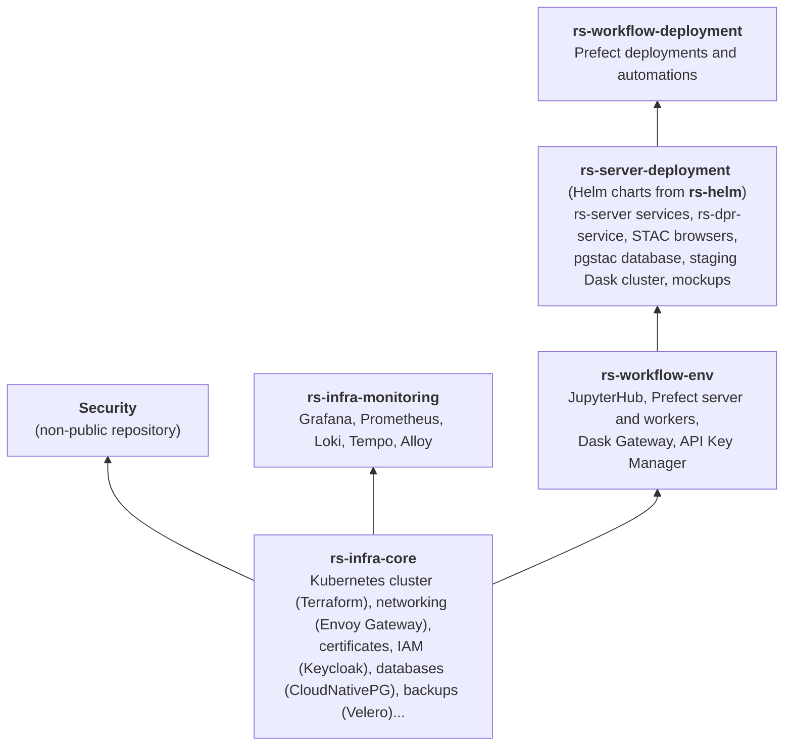
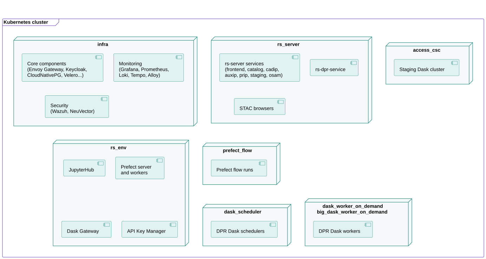

# Deploy RS-Python

RS-Python has two deployment targets:

- the **cluster mode**, the nominal mode, where all the components are deployed on a
  [Kubernetes](https://kubernetes.io/) cluster. This page describes it.
- the **local mode**, used by the developers to run the services, a Jupyter server and the station mockups on
  their own computer with [Docker Compose](https://docs.docker.com/compose/), without authentication. See
  [Local mode](../rs-demo/docs/local-mode.md).


## Overview

The cluster deployment is made of layers, each one implemented by a GitHub repository and deployed on top of the
previous ones:



All the layers are deployed with the same mechanism, provided by the `apps.yaml`
[Ansible](https://docs.ansible.com/) playbook of [rs-infra-core](../rs-infra-core/README.md):

- each repository contains an `apps/` folder (a *package*), made of one sub-folder per application,
- each application folder contains a [Kustomize](https://kustomize.io/) `kustomization.yaml` file, that can
  reference [Helm charts](https://helm.sh/docs/topics/charts/) (e.g. from [rs-helm](../rs-helm/README.md)) and
  Kubernetes manifests,
- all the files are [Jinja2](https://jinja.palletsprojects.com/) templates, rendered with the variables of your
  **inventory** (domain name, credentials, sizing...),
- the applications are deployed in the alphabetical order of their folder names: the `NN-` prefix of the folder
  names gives the deployment order (e.g. `00-namespaces`, `01-cert-manager`...),
- the playbook waits for the deployed resources to be ready before deploying the next application.

```shell
# Deploy all the applications of a package
ansible-playbook apps.yaml -i inventory/mycluster/hosts.yaml -e '{"package_paths": ["~/rs-workflow-env/apps/"]}'

# Deploy (or redeploy) a single application of a package, e.g. "jupyterhub"
ansible-playbook apps.yaml -i inventory/mycluster/hosts.yaml -e '{"package_paths": ["~/rs-workflow-env/apps/"]}' -e app=jupyterhub
```

The inventory, that contains the configuration and the credentials of your platform, is specific to each
platform: keep it in a private repository or in a secret manager (see
[Credentials](../rs-infra-core/docs/how-to/credentials.md)).

## Deployment steps

| Step | Repository | Documentation |
|---|---|---|
| 1. Create the Kubernetes cluster and deploy the core infrastructure | [rs-infra-core](https://github.com/RS-PYTHON/rs-infra-core) | [Infrastructure installation](../rs-infra-core/docs/installation.md) |
| 2. Deploy the monitoring | [rs-infra-monitoring](https://github.com/RS-PYTHON/rs-infra-monitoring) | [rs-infra-monitoring](../rs-infra-monitoring/README.md) |
| 3. Deploy the security components ([Wazuh](https://wazuh.com/), [NeuVector](https://github.com/neuvector/neuvector)) | non-public repository | |
| 4. Deploy the virtual environment | [rs-workflow-env](https://github.com/RS-PYTHON/rs-workflow-env) | [rs-workflow-env](../rs-workflow-env/README.md) |
| 5. Deploy the RS-Python services | [rs-server-deployment](https://github.com/RS-PYTHON/rs-server-deployment), [rs-helm](https://github.com/RS-PYTHON/rs-helm) | [rs-server-deployment](../rs-server-deployment/README.md), [rs-helm](../rs-helm/README.md) |
| 6. Deploy the Prefect flows | [rs-workflow-deployment](https://github.com/RS-PYTHON/rs-workflow-deployment) | [rs-workflow-deployment](../rs-workflow-deployment/README.md) |
| 7. Create the user accounts and initialise the processing environment | | [Create accounts and assign permissions](accounts-permissions.md), [Initialise the processing environment](init-processing-environment.md) |

The deployment on the cluster is organised in **node pools**, so that each kind of workload runs on dedicated
nodes:



| Node pool | Workloads |
|---|---|
| `infra` | Core, monitoring and security components. |
| `rs_server` | The rs-server web services, rs-dpr-service and the STAC browsers. |
| `access_csc` | The components that access the Copernicus Space Component (CSC) external data sources, e.g. the staging Dask cluster. |
| `rs_env` | The virtual environment: JupyterHub, Prefect server and workers, Dask Gateway, API Key Manager. |
| `prefect_flow` | The Prefect flow runs. |
| `dask_scheduler` | The schedulers of the Dask clusters that run the DPR processors. |
| `dask_worker_on_demand`, `big_dask_worker_on_demand` | The workers of the Dask clusters that run the DPR processors, with standard or big resources. |

The pods are assigned to the node pools with the `node-role.kubernetes.io/<node-pool>` node labels.
The node pools, their sizing and their autoscaling are defined in the `cluster.tfvars` file of your inventory. See also
[Isolation between user groups](../rs-infra-core/docs/how-to/isolation-user-groups.md) to deploy several
virtual environments on the same cluster.
