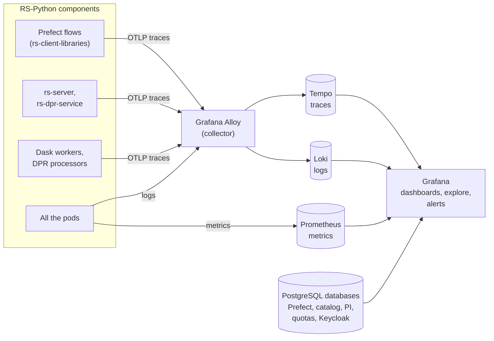

# Monitoring and observability

RS-Python is instrumented with [OpenTelemetry](https://opentelemetry.io/), and its monitoring stack is deployed by
[rs-infra-monitoring](../rs-infra-monitoring/README.md):

| Component | Usage | URL on the reference platform |
|---|---|---|
| [Grafana](https://grafana.com/docs/grafana/latest/) | Dashboards, exploration of the logs, metrics and traces, alerts. | <https://monitoring.ops.rs-python.eu> |
| [Prometheus](https://prometheus.io/docs/) | Metrics of the Kubernetes cluster, of the nodes and of the pods. | <https://monitoring.ops.rs-python.eu/prometheus> |
| [Loki](https://grafana.com/docs/loki/latest/) | Logs of all the pods. | through Grafana |
| [Tempo](https://grafana.com/docs/tempo/latest/) | Traces of the requests, from the Prefect flows to the services and the Dask workers. | through Grafana |
| [Grafana Alloy](https://grafana.com/docs/alloy/latest/) | Collects the logs and the OpenTelemetry traces and sends them to Loki and Tempo. | |

## Data sources

The following Grafana data sources are configured at deployment time:

| Data source | Content |
|---|---|
| `Prometheus` | Metrics. |
| `Loki` | Logs, linked to the traces by their `trace_id`. |
| `tempo` | Traces. |
| `Postgres-Prefect` | The Prefect database: flow runs, task runs, states. |
| `Postgres-cnpgstac` | The catalog database ([pgstac](https://github.com/stac-utils/pgstac)). |
| `Postgres-rs_server` | The jobs of the staging and processing services. |
| `Postgres-performance` | The [performance indicators](../rs-client-libraries/docs/doc/operation/performance-indicators.md). |
| `Postgres-s3quotamonitoring` | The [object storage quota monitoring](../rs-client-libraries/docs/doc/operation/quota-monitoring.md). |
| `Postgres-Keycloak` | The Keycloak database. |

## Usual checks

| What | How |
|---|---|
| Health of the Kubernetes cluster and of the nodes | The *Kubernetes* dashboards of Grafana, fed by Prometheus. |
| Resources consumed by a processor or a flow | The *Kubernetes / Views / Pods* dashboard, e.g. with the `dask-gateway` namespace for the Dask clusters or the `processing` namespace for the flow runs. |
| Errors of a service | The logs in *Explore* with the `Loki` data source, filtered by namespace and pod. |
| Duration of each step of a flow run | The traces in *Explore* with the `tempo` data source, e.g. with the `rs.workflows` service name. |
| Production completeness and timeliness | The [performance indicators](../rs-client-libraries/docs/doc/operation/performance-indicators.md). |
| Object storage usage and costs | The [object storage quota monitoring](../rs-client-libraries/docs/doc/operation/quota-monitoring.md). |

See also [Troubleshooting](../advanced/troubleshooting.md).

## Instrumentation

The Python components export their traces with the [OpenTelemetry Python SDK](https://opentelemetry.io/docs/languages/python/)
and its automatic instrumentation of [FastAPI](https://fastapi.tiangolo.com/),
[requests](https://requests.readthedocs.io/)... to the endpoint given by the `TEMPO_ENDPOINT` environment variable.
The request headers and bodies can be added to the traces, for debugging purposes, with the
`OTEL_PYTHON_REQUESTS_TRACE_HEADERS` and `OTEL_PYTHON_REQUESTS_TRACE_BODY` environment variables (or the
`otel.trace_headers` and `otel.trace_body` values of the Helm charts).
