# System architecture

This page describes the architecture of the RS-Python system as a whole. The architecture of each component is
described in its own repository, e.g. [rs-server](../rs-server/docs/doc/index.md) or
[rs-dpr-service](../rs-dpr-service/docs/doc/index.md).

## Main components

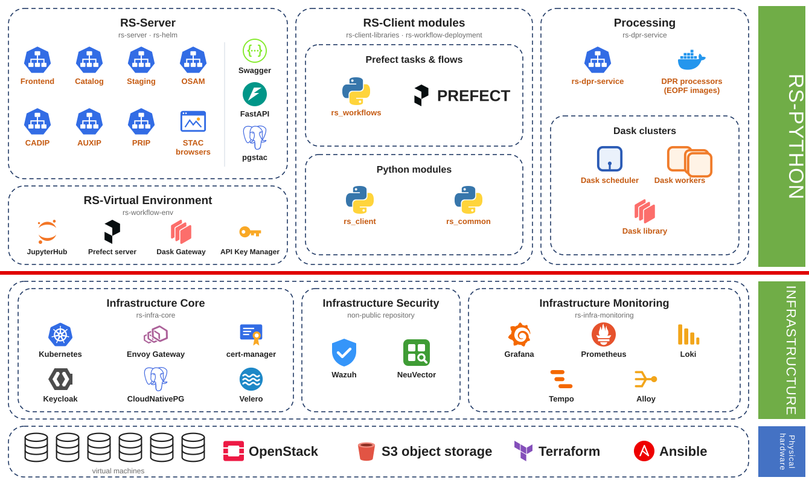

| Layer | Components | Repositories |
|---|---|---|
| RS-Python | Web services (frontend, catalog, external data sources, staging, OSAM), STAC browsers | [rs-server](https://github.com/RS-PYTHON/rs-server), [rs-helm](https://github.com/RS-PYTHON/rs-helm), [rs-server-deployment](https://github.com/RS-PYTHON/rs-server-deployment) |
| | Python libraries and Prefect flows | [rs-client-libraries](https://github.com/RS-PYTHON/rs-client-libraries), [rs-workflow-deployment](https://github.com/RS-PYTHON/rs-workflow-deployment) |
| | DPR service and processors | [rs-dpr-service](https://github.com/RS-PYTHON/rs-dpr-service), [rs-workflow-env](https://github.com/RS-PYTHON/rs-workflow-env) (Docker images of the processors) |
| | Virtual environment: JupyterHub, Prefect, Dask Gateway, API Key Manager | [rs-workflow-env](https://github.com/RS-PYTHON/rs-workflow-env) |
| Infrastructure | Core: Kubernetes, Envoy Gateway, cert-manager, Keycloak, CloudNativePG, Velero... | [rs-infra-core](https://github.com/RS-PYTHON/rs-infra-core) |
| | Monitoring: Grafana, Prometheus, Loki, Tempo, Alloy | [rs-infra-monitoring](https://github.com/RS-PYTHON/rs-infra-monitoring) |
| | Security: Wazuh, NeuVector | non-public repository |
| Physical infrastructure | Cloud provider (OpenStack virtual machines, S3 object storage), provisioned with Terraform and Ansible | [rs-infra-core](https://github.com/RS-PYTHON/rs-infra-core) |

The detailed list of the third-party components and their licenses is given in the *Third-party components*
annexes.

## Collaboration between the components

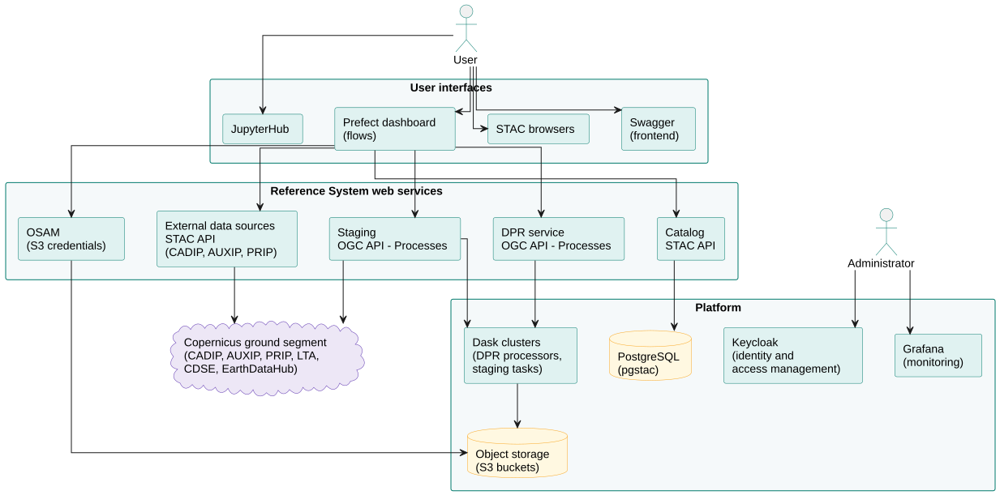

- The users interact with the system through [JupyterHub](../services/virtual-environment/jupyterhub.md), the
  [Prefect dashboard](../services/virtual-environment/prefect.md), the [STAC browsers](../services/browse-products.md)
  and the [Swagger page](../services/swagger.md). They are all authenticated by Keycloak.
- The [Prefect flows](../rs-client-libraries/docs/doc/flows/index.md) implement the processing chains. They call
  the web services with the [rs-client-libraries](../rs-client-libraries/docs/doc/index.md), authenticated with
  the API key of the user.
- All the web services are exposed by [Envoy Gateway](https://gateway.envoyproxy.io/) behind a single domain name,
  and check the rights of the user for each request.
- The [external data sources](../rs-server/docs/doc/users/external-data-sources.md) services translate the STAC
  requests into OData requests to the Copernicus stations.
- The [staging](../rs-server/docs/doc/users/staging.md) and the [processing](../rs-dpr-service/docs/doc/index.md)
  services run their tasks on Dask clusters, and write the products in the object storage.
- The [catalog](../rs-server/docs/doc/users/catalog.md) stores the metadata of the products in a PostgreSQL
  database ([pgstac](https://github.com/stac-utils/pgstac)).

The Python modules depend on each other as follows:

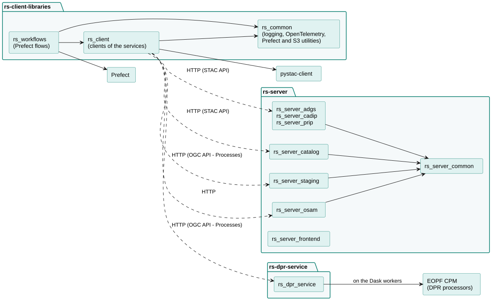

Each kind of data follows a lifecycle, from its staging or generation to its deletion, described in
[Catalog data model and lifecycle](../rs-server/docs/doc/users/data-model.md).

## Deployment

The deployment on a Kubernetes cluster, in several layers and node pools, is described in
[Deploy RS-Python](../administration/deploy.md). The local mode, used for the development, is described in
[Local mode](../rs-demo/docs/local-mode.md).

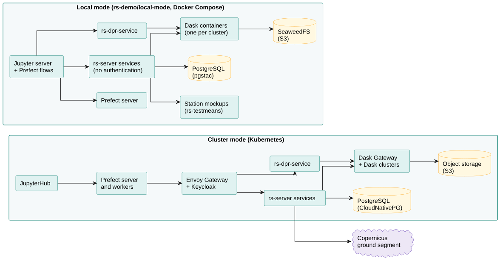

## Actors

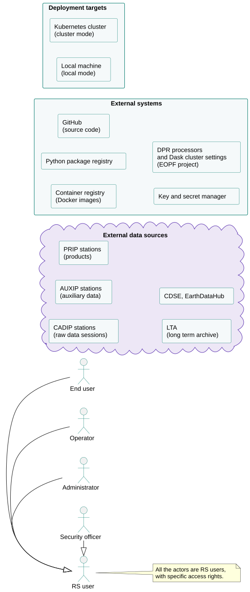

All the actors are *RS users*, with specific access rights: end users, operators, administrators and security
officers. The external data sources provide the raw data and auxiliary data needed by the processing chains. The DPR
processors and the settings of the Dask clusters that run them are delivered by the
[EOPF](https://eopf.copernicus.eu/) project. Two targets are supported to deploy RS-Python: a local machine and a
Kubernetes cluster.

## Use cases

### Access control

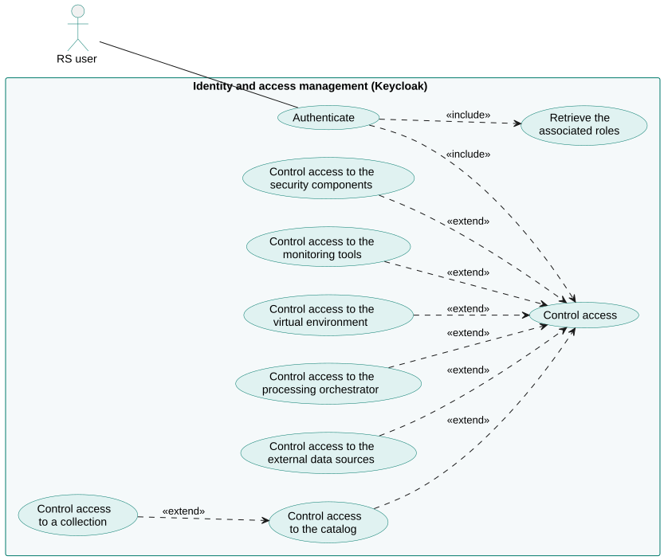

### External data sources and staging

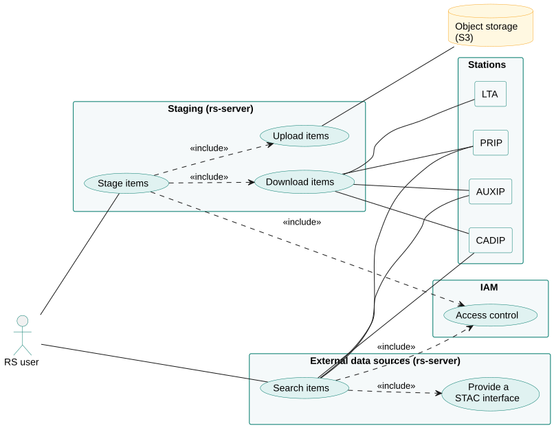

### Catalog

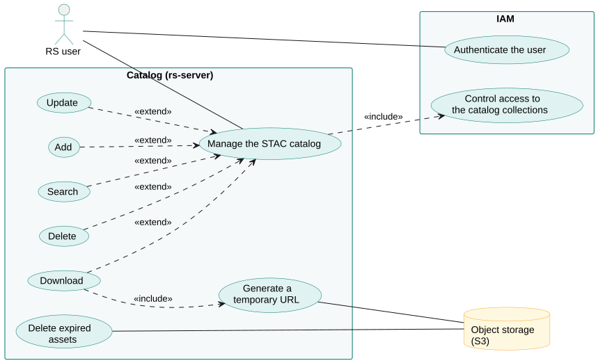

### Processing

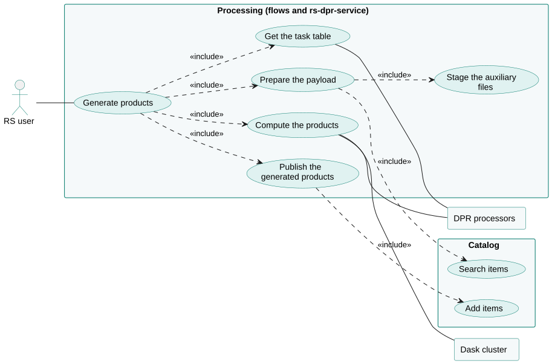

### Workflow management

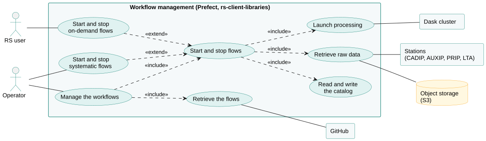

### Dask clusters

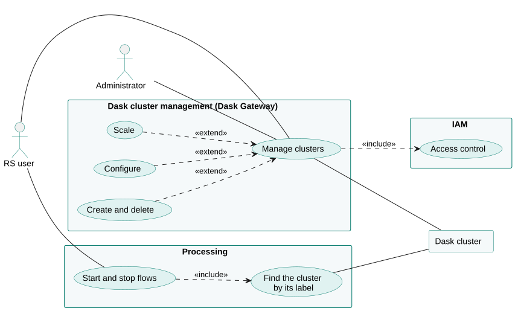

### Infrastructure

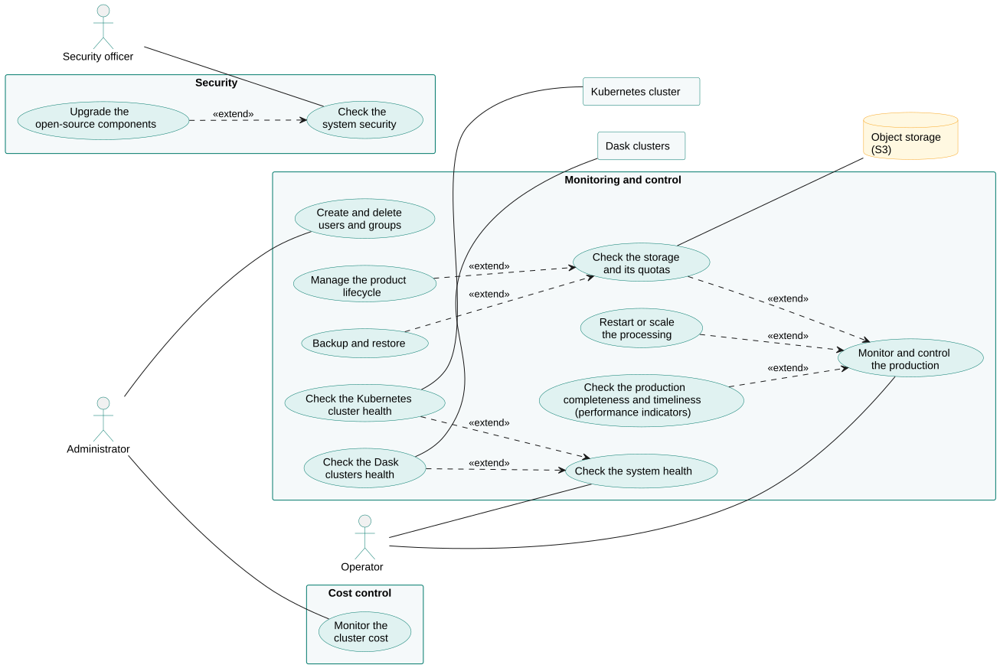

### Deployment

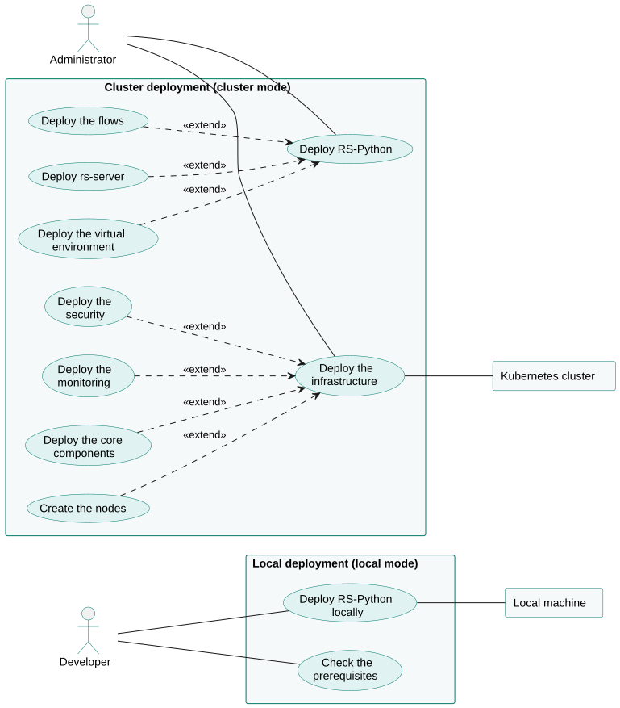
