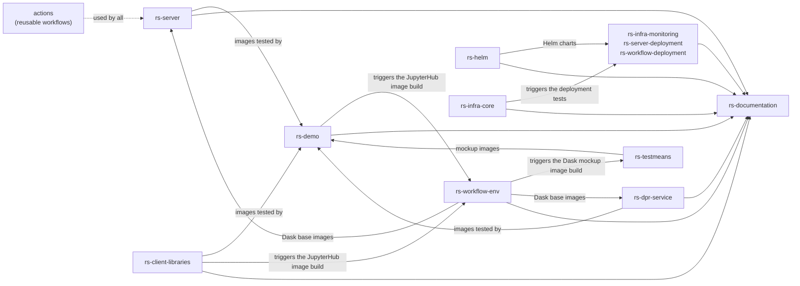

# Repositories and CI/CD

The source code is split into several repositories, described in
[Project organisation](../getting-started/project-organisation.md#source-code-organisation). Their CI/CD is
implemented with [GitHub Actions](https://docs.github.com/en/actions), using the reusable workflows and composite
actions of the [actions](../actions/README.md) repository.

## Branches and versions

- The default branch of the repositories is `develop` ([git-flow](https://git-flow.readthedocs.io/en/latest/presentation.html)).
  The features are developed in branches named `feat-<ticket-id>/<short-description>` and merged with pull
  requests.
- The releases are identified by git tags, e.g. `v1.0a14` (alpha version of the sprint), `v1.0rc1` (release
  candidate) or `v1.0` (release). The same version is used by all the repositories of a release.
- The version of the Python packages is computed from the git tag by
  [poetry-dynamic-versioning](https://github.com/mtkennerly/poetry-dynamic-versioning), e.g. `1.0a14` for the
  `v1.0a14` tag.
- The Docker images are tagged with the branch name, plus `latest` for the `develop` branch, or with the version
  name for a git tag, e.g. `ghcr.io/rs-python/rs-server-catalog:1.0a14`.
- [Dependabot](https://docs.github.com/en/code-security/dependabot) proposes the updates of the dependencies.

## Workflows

| Workflow | Repositories | Description |
|---|---|---|
| Check code quality | All | [pre-commit](https://pre-commit.com/), license headers, [Trivy](https://trivy.dev/), [Bandit](https://bandit.readthedocs.io/), [Flake8](https://flake8.pycqa.org/), [mypy](https://mypy-lang.org/), [Pylint](https://pylint.readthedocs.io/), [Safety](https://safetycli.com/), [pytest](https://docs.pytest.org/), [SonarQube](https://www.sonarsource.com/products/sonarqube/). Run on each push and pull request, see [Contributing](contributing.md#code-style). |
| Publish wheels and Docker images | rs-server, rs-client-libraries, rs-dpr-service, rs-testmeans | Build the Python wheels, publish them on [PyPI](https://pypi.org/) for the releases, build the Docker images with a temporary tag, test them by running the [rs-demo](../rs-demo/README.md) notebooks in local mode, then push them with their final tags to the [GitHub Container Registry](https://github.com/orgs/RS-PYTHON/packages). |
| Run all demos | rs-demo | Run all the demo notebooks in local mode. |
| Build the Docker images | rs-workflow-env | Build the base images (Python, Jupyter, Dask), the Dask images of the DPR processors and the JupyterHub image. See [Dask images](../rs-workflow-env/docs/dask_images.md). |
| Lint, test, document and publish the Helm charts | rs-helm | Lint the charts, generate their README with [helm-docs](https://github.com/norwoodj/helm-docs), publish them in the [Helm repository](https://home.rs-python.eu/rs-helm). |
| Test deployment | rs-infra-core, rs-infra-monitoring, rs-workflow-env, rs-server-deployment, rs-workflow-deployment | Deploy the applications with the Ansible playbooks on a test Kubernetes cluster created in the CI. rs-infra-core triggers the test of the downstream repositories. |
| Generate documentation | rs-documentation | Build this website from all the repositories, and publish it from the `develop` branch, see [Generate the documentation](generate-documentation.md). |

## Dependencies between the repositories

## Docker images

All the images are published in the [GitHub Container Registry](https://github.com/orgs/RS-PYTHON/packages) under
`ghcr.io/rs-python/`:

| Images | Built by | Content |
|---|---|---|
| `rs-server-adgs`, `rs-server-cadip`, `rs-server-prip`, `rs-server-catalog`, `rs-server-staging`, `rs-server-osam`, `rs-server-frontend` | rs-server | The rs-server web services. |
| `dask/staging/k8s`, `dask/staging/local` | rs-server | The Dask images of the staging, for the cluster and local modes. |
| `rs-dpr-service_py<python>-<dask>` | rs-dpr-service | rs-dpr-service, one image per Python and Dask version used by the Dask clusters of the processors. |
| `dask/<processor>/k8s`, `dask/<processor>/local` | rs-workflow-env | The Dask images of the DPR processors. |
| `dask/dask-gateway`, `quay.io/jupyter/base-notebook`... | rs-workflow-env | Base images. |
| JupyterHub image | rs-workflow-env | The JupyterHub image with the rs-client-libraries. |
| `rs-testmeans_<station>-station-mock`, `dask/mockup/k8s`, `dask/mockup/local` | rs-testmeans | Mockups of the stations (ADGS, CADIP, PRIP, LTA) and Dask images of a mockup DPR processor. |

The OpenAPI specification of all the services, displayed by the frontend, is built by the rs-server CI, see
[Frontend](../rs-server/docs/doc/users/frontend.md).
