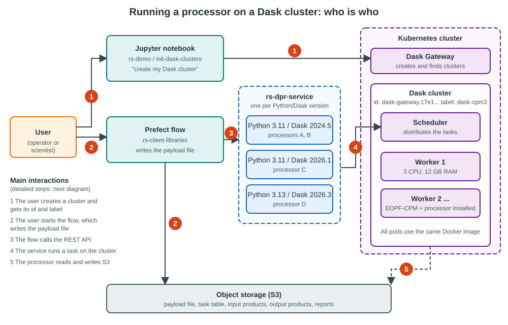
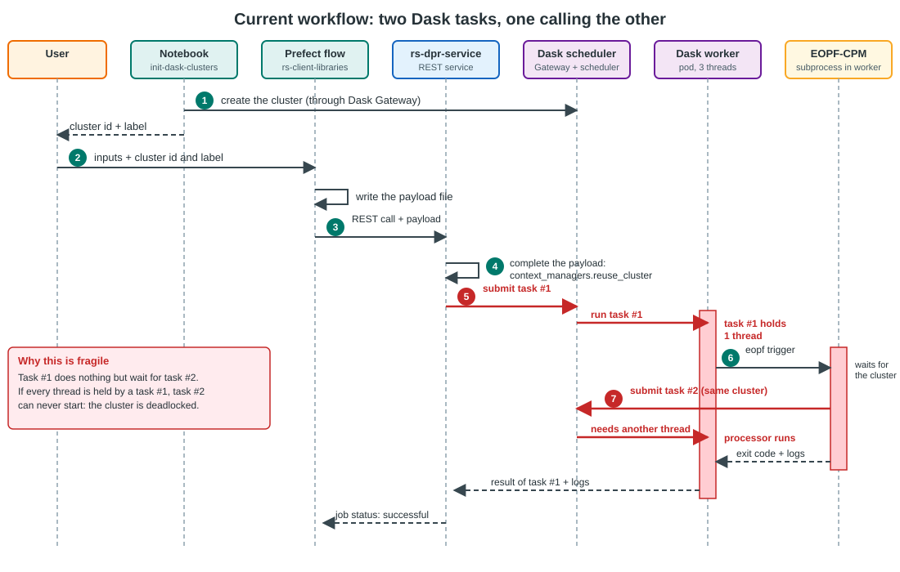
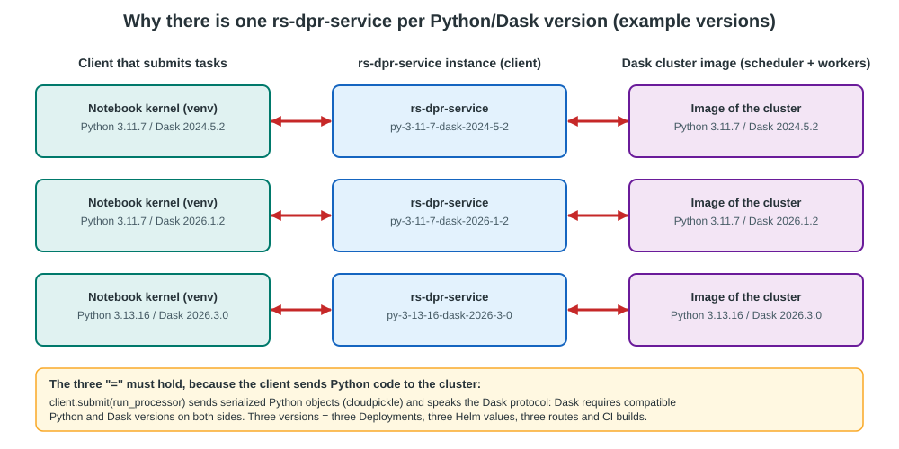
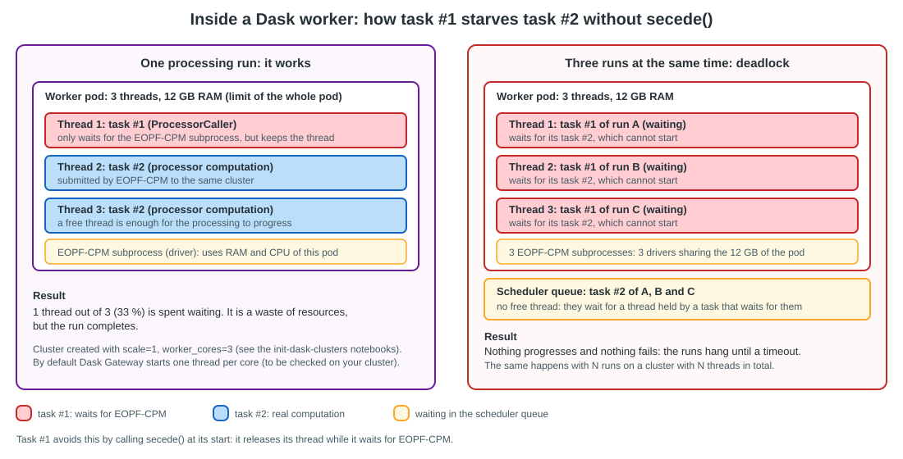
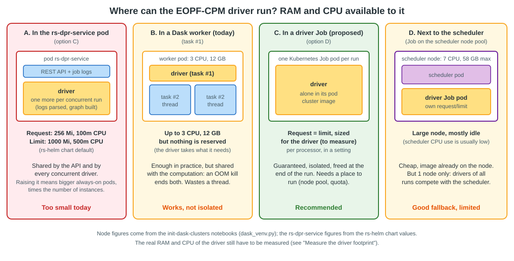
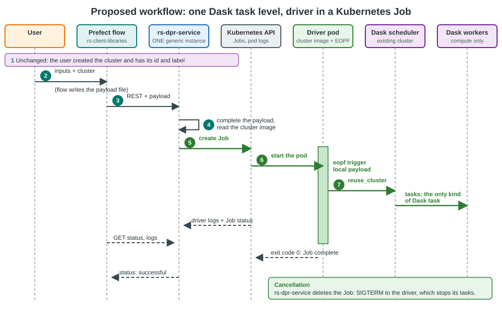
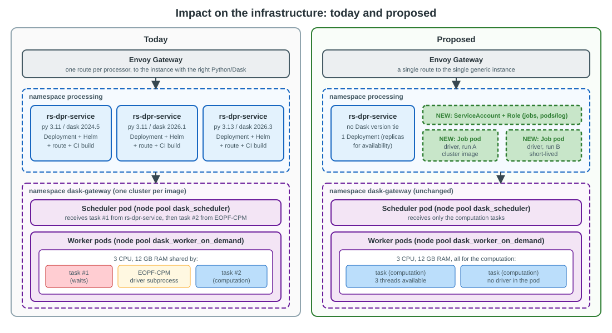
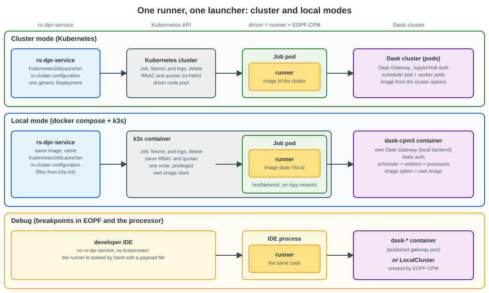

# Running a DPR processor on a Dask cluster: architecture review

This page explains how a DPR processor is run on a [Dask](https://www.dask.org/) cluster, analyses the strengths and
weaknesses of the current design, and proposes a better one, with its impact on the infrastructure. It is written
for the developers and the infrastructure operators of RS-Python, and the first sections are meant for beginners.

> **Status**
>
> Sections 1 to 4 describe the system **as implemented today**, checked against the source code of
> [rs-dpr-service](https://github.com/RS-PYTHON/rs-dpr-service),
> [rs-demo](https://github.com/RS-PYTHON/rs-demo) and [EOPF-CPM](https://cpm.pages.eopf.copernicus.eu/eopf-cpm/main/index.html).
> Sections 5 to 9 are an **architecture proposal**, not yet implemented, except the `secede()` call of
> [option B](#5-options), which is in place. The points that could not be verified from
> the code are listed in [Assumptions to verify](#10-assumptions-to-verify).
>
> A key constraint drives the whole analysis: the pod of rs-dpr-service is small (see
> [The resource constraint](#the-resource-constraint-where-can-the-eopf-cpm-driver-run)), so the EOPF-CPM driver
> **cannot** run there. Any proposal must give the driver enough RAM and CPU.

## 1. Vocabulary for beginners

| Term | Meaning |
|---|---|
| **Processor** | A scientific program (e.g. Sentinel-1 level-1 processing) written with EOPF-CPM. It reads input products and writes output products. |
| **EOPF-CPM** | *Earth Observation Processing Framework - Core Python Modules*. The library that runs a processor from a *payload file* (command `eopf trigger local payload.yaml`). |
| **Payload file** | A YAML file that describes a run: inputs, outputs, parameters, and how to connect to Dask (the `context_managers` field). |
| **Dask** | A Python library that splits a computation into many small **tasks** and runs them in parallel. |
| **Scheduler** | The Dask component that receives the tasks and distributes them to the workers. |
| **Worker** | A Dask process (here a Kubernetes pod) that executes the tasks. It has a number of **threads**: one thread runs one task at a time. |
| **`secede()`** | A Dask function that a running task calls to leave the thread pool of its worker. The worker starts a new thread for the other tasks. It is meant for tasks that mostly wait. |
| **Dask cluster** | One scheduler plus several workers, all started from the same Docker image. |
| **Dask Gateway** | The service that creates, lists and stops the Dask clusters on Kubernetes. |
| **Cluster id / label** | The *id* (e.g. `dask-gateway.17e196...`) identifies one running cluster. The *label* (e.g. `dask-cpm3`) is a human-readable name. |
| **Client** | Any program that submits tasks to a cluster (a notebook, rs-dpr-service, EOPF-CPM...). |
| **Prefect flow** | A Python workflow, started from the Prefect dashboard, that orchestrates a processing. |
| **rs-dpr-service** | The REST service ([OGC API - Processes](https://ogcapi.ogc.org/processes/)) that runs the processors. See [DPR processors](../rs-dpr-service/docs/doc/index.md). |

## 2. Overview



Four building blocks cooperate:

1. The **user's notebook** creates a Dask cluster with Dask Gateway.
2. A **Prefect flow** ([rs-client-libraries](https://github.com/RS-PYTHON/rs-client-libraries)) gathers the user's
   inputs and writes the payload file.
3. **rs-dpr-service** receives a REST call, completes the payload and runs the processor.
4. The **Dask cluster** executes the processor, next to the object storage (S3) that contains the products.

## 3. How it works today

The user first creates a cluster with one of the notebooks of
[rs-demo/notebooks/init-dask-clusters](https://github.com/RS-PYTHON/rs-demo/tree/develop/notebooks/init-dask-clusters)
(one notebook per processor family: `cpm3`, `l0`, `s1ard`, `s3olci`, `mockup`, `staging`). See also
[Add and delete Dask clusters](../rs-workflow-env/docs/dask-clusters.md). The notebook starts the cluster from a
Docker image, then prints its **instance id** and its **label**.



| # | Who | What |
|---|---|---|
| 1 | User, notebook | Creates the Dask cluster and gets its id and label. The notebook must run in a kernel whose Python and Dask versions match the cluster image (it checks it with `assert`). |
| 2 | Prefect flow | Reads the user's input (including the cluster id and label) and writes the payload file. |
| 3 | Prefect flow | Calls rs-dpr-service with a REST request `POST /processes/{processor}/execution` and the payload. |
| 4 | rs-dpr-service | Completes the payload, in particular the `context_managers` field. It contains the `reuse_cluster` parameter set to the cluster id of step 1 (see [`write_dask_context`](https://github.com/RS-PYTHON/rs-dpr-service/blob/develop/rs_dpr_service/dask/call_dask.py)). |
| 5 | rs-dpr-service | Connects to the cluster through Dask Gateway and submits **task #1**: `ProcessorCaller.run_processor`. |
| 6 | Task #1 (in a worker) | Calls `secede()` to release its worker thread, downloads the configuration from S3, then starts the EOPF-CPM job in a subprocess: `eopf_otel trigger local payload.yaml`. It streams the logs and handles the cancellation (Dask event). |
| 7 | EOPF-CPM | Reads `context_managers`, connects to the **same cluster** thanks to `reuse_cluster`, and submits **task #2**: the actual computation of the processor, split into many Dask tasks. |

### Why one rs-dpr-service instance per processor family



The processors do not all use the same Python and Dask versions. A Dask client and its cluster must use compatible
versions, so rs-dpr-service, which is a Dask client in step 5, must have **the same Python and Dask versions as the
processor**. It is the reason why several instances of rs-dpr-service are deployed in the `processing` namespace
(see [rs-server-deployment/apps](https://github.com/RS-PYTHON/rs-server-deployment/tree/develop/apps), e.g.
`rs-dpr-service-py-3-11-7-dask-2024-5-2`, `rs-dpr-service-py-3-11-7-dask-2026-1-2` and
`rs-dpr-service-py-3-13-16-dask-2026-3-0`), and why the gateway routes each processor to the right instance.

The same constraint applies to the notebook kernel that creates the cluster.

## 4. Assessment of the current method

The method nests two levels of Dask tasks on the same cluster: task #1 (the "launcher") starts EOPF-CPM, which
submits task #2 (the computation) to the same workers.

### Pros

| Pro | Explanation |
|---|---|
| **The driver gets enough RAM and CPU** | This is the main reason for the design. The pod of rs-dpr-service is small (request 256 Mi and 100m CPU, limit 1000 Mi and 500m CPU in the [rs-helm chart](https://github.com/RS-PYTHON/rs-helm/blob/develop/charts/rs-dpr-service/values.yaml)). Running `eopf trigger` inside a worker pod gives it access to the resources of a worker (up to 3 CPU and 12 GB RAM on the `dask_worker_on_demand` pool). The resources are *available*, not *reserved*: see the matching con below. |
| **No new component** | Everything goes through Dask Gateway and the existing clusters. rs-dpr-service needs no Kubernetes permission. |
| **Right environment by construction for EOPF-CPM** | The EOPF-CPM driver runs inside a pod created from the cluster image, so its Python, Dask and processor versions are exactly those of the cluster. |
| **Driver close to the data and the scheduler** | The EOPF-CPM driver talks to the scheduler from inside the Kubernetes network, with a low latency and no long-lived connection through the gateway. |
| **Cancellation and log streaming already work** | A Dask `Event` stops the subprocess, and the logs are forwarded to rs-dpr-service and Prefect (see [Cancel a DPR run](../rs-dpr-service/docs/doc/cancel-dpr-run.md)). |
| **Quotas are enforced in one place** | The cluster options (`cluster_max_workers`, `cluster_max_cores`, `cluster_max_memory`) cap what a run can consume. |
| **Simple to operate on small setups** | One cluster, one service, no job controller. |

### Cons

| Con | Explanation | Severity |
|---|---|---|
| **Two levels of tasks, deadlock risk mitigated** | Task #1 only waits for task #2. If it kept its worker thread during the whole run, *N* runs sharing a cluster with at most *N* threads (e.g. 3 concurrent runs on one worker of 3 cores) would leave no thread for any task #2: the runs would hang without failing (see the diagram below). This only concerns the processors whose EOPF-CPM submits tasks to the cluster. Task #1 avoids it by calling `secede()` at its start ([`ProcessorCaller.run_processor`](https://github.com/RS-PYTHON/rs-dpr-service/blob/develop/rs_dpr_service/dask/call_dask.py)): the worker starts a new thread, so all its threads stay available for task #2. | Low |
| **The driver resources are shared, not reserved** | The EOPF-CPM subprocess (graph construction, in-process orchestration, S3 transfers, logging) takes RAM and CPU from the worker pod that also runs the tasks, and the worker runs as many tasks #2 as it has threads next to it. Nothing guarantees the driver a minimum, and Dask's memory manager does not see the subprocess memory. An out-of-memory kill of the pod kills the driver and the computation together. This is the other side of the first pro. | High |
| **A worker failure can replay the whole run** | Dask reschedules the tasks of a lost worker (`distributed.scheduler.allowed-failures`, 3 by default). Task #1 is the whole processor run, so it may be started again with its side effects (outputs written twice). | Medium |
| **Version coupling** | rs-dpr-service must match the Python and Dask versions of each processor, hence one Deployment, Helm values, route and CI build per version. Adding a processor with a new Python or Dask version means deploying a new instance. | High |
| **Secrets travel through Dask** | The JupyterHub API token and the S3 credentials are put in the serialized task, so they pass through the scheduler. | Medium |
| **Harder to observe and debug** | A failure can be in the REST service, in task #1, in the subprocess or in task #2. Task #1 shows as a long task in the Dask dashboard that is not real work. | Low |
| **Opaque lifecycle** | A run is a Python task, not a Kubernetes object: no `kubectl get jobs`, no TTL, no native deadline. | Low |

The diagram below shows the thread starvation that `secede()` prevents, when task #1 keeps its thread.



**Conclusion.** The idea is not wrong: running the driver next to the scheduler, from the cluster image, with
more RAM and CPU than the service pod, is sound and it is a real requirement. The weakness is *how* the driver
gets its resources. Putting it in a Dask task makes it consume, without any reservation, the resources of the
workers it is supposed to orchestrate, and keeps rs-dpr-service tied to the Dask version. The nested task can also
deadlock the cluster: `secede()` removes this risk, but not the other cons.

### The resource constraint: where can the EOPF-CPM driver run?

The driver is the process that runs `eopf trigger`: it loads the payload, builds the workflow, connects to the
Dask cluster as a client, submits the tasks, follows their progress and finalises the products (`EORunner.run` in
[EOPF-CPM](https://cpm.pages.eopf.copernicus.eu/eopf-cpm/main/index.html)). Its RAM and
CPU needs depend on the processor and on the size of the products, and we do not have measurements yet (see
[Measure the driver footprint](#measure-the-driver-footprint)). What is known:

- the service pod is far too small for it: limit of 1000 Mi and 500m CPU, shared with the REST API and with all the
  runs of this instance;
- several runs can be in progress at the same time, each with its own driver;
- the EOPF-CPM release notes already mention memory issues in the staging and S3 upload code (e.g. "High memory
  usage when uploading staged products to S3", #1251).



| Placement | RAM and CPU for the driver | Isolated from the computation | Removes nested tasks | Removes version coupling | Verdict |
|---|---|---|---|---|---|
| **A. In the rs-dpr-service pod** | Too small today. Raising the limits means bigger always-on pods, multiplied by the number of instances (one per Python/Dask version), sized for the worst case of concurrent runs. | No: shared with the API and the other drivers | Yes | No | Rejected |
| **B. In a Dask worker** (today) | Up to the worker size (3 CPU, 12 GB), but not reserved | No | No | No | Works, fragile |
| **C. In a Kubernetes Job** | Requested and limited for the driver alone, set per processor | Yes | Yes | Yes | **Recommended** |
| **D. In a Job on the scheduler node pool** | Large node (up to 7 CPU, 58 GB), mostly used by the scheduler memory request | Yes (own pod) | Yes | Yes | Fallback, a single node |

Scaling rs-dpr-service horizontally does not fix placement A: a run is long, its state and logs live in the
instance that started it, so the load cannot be rebalanced, and a pod sized for the largest driver is idle most of
the time.

### Measure the driver footprint

Before fixing the size of the driver, measure it, for the heaviest processors and for several concurrent runs:

| What | How |
|---|---|
| Peak RAM and CPU of the driver | Run the proof of concept with a Job without limits and read `kubectl top pod` and the Prometheus metrics `container_memory_working_set_bytes` and `container_cpu_usage_seconds_total` of the driver pod (Grafana, [rs-infra-monitoring](https://github.com/RS-PYTHON/rs-infra-monitoring)). |
| Same figure in the current design | Compare the memory of the worker *pod* (cgroup metrics) with the memory reported by Dask for the worker process in the dashboard: the difference is the driver subprocess (and the other processes of the pod). |
| Memory timeline of the computation | EOPF-CPM has a Dask memory sampler and a performance report, enabled by the Dask context settings of the payload (see the `DaskContext` class). |
| Effect of the products size | Repeat with the smallest and the biggest products of each processor. |

Keep the maximum measured, add a margin (e.g. 25 %), and use it as the request and limit of the driver.

## 5. Options

| Option | Description | Removes nested tasks | Removes version coupling | Enough RAM/CPU for the driver | Infrastructure change | Effort |
|---|---|---|---|---|---|---|
| **A. Keep as is** | Reference: the current design, including the `secede()` of option B. | No | No | Yes, but not reserved | None | None |
| **B. Mitigate in place** (implemented) | Keep the design. Task #1 calls [`secede()`](https://distributed.dask.org/en/stable/task-launch.html) at its start, so it releases its thread while it waits. Other possible mitigations: start the workers with more threads than cores, or use one cluster per run. | Partly (no more deadlock, still two levels) | No | Same as A | None | Small |
| **B2. Reserve the driver in Dask** | Keep the design, but tag task #1 with a [Dask worker resource](https://distributed.dask.org/en/stable/resources.html) (e.g. `DRIVER=1`) and size the workers so that a driver always has its share: at most one driver per worker, and a worker size that includes the driver. On top of the `secede()` of option B. | Partly | No | Better: bounded number of drivers per worker, but still no memory reservation | Cluster options (worker `--resources`), to be verified with Dask Gateway | Small to medium |
| **C. Driver in rs-dpr-service** | rs-dpr-service runs `eopf trigger` itself (subprocess in its own pod); EOPF-CPM connects to the cluster. No task #1. | Yes | No (EOPF-CPM must be installed in each instance, with the right versions) | **No**: pod of 1000 Mi / 500m CPU, to be multiplied and kept always on | Much bigger pods | Medium |
| **D. One Kubernetes Job per run (recommended)** | rs-dpr-service creates a short-lived Kubernetes Job from the **cluster image**, with its own requests and limits. The Job runs `eopf trigger`, which connects to the existing cluster. | Yes | **Yes**: a single generic rs-dpr-service | **Yes, reserved and sized per processor** | New RBAC, driver pods, quotas, node pool | Medium |
| **E. Prefect-native** | The Prefect flow itself starts the Kubernetes Job (Prefect Kubernetes work pool), and rs-dpr-service disappears or only keeps the catalogue of processors. | Yes | Yes | Yes (work pool job template) | Prefect work pool | Large (changes the public API) |

**Why not C.** It removes the nested task, but the service pod has 1000 Mi and 500m CPU, far less than a driver
may need. Making it big enough means big always-on pods, one set per Python/Dask version, that must absorb the
drivers of all the concurrent runs, without isolation between the runs of different users, and with no way to
spread the load. It also keeps EOPF-CPM, Python and Dask in each rs-dpr-service image: the version coupling
remains. This option is not kept, even for the local mode, which also runs the driver in a Job (see
[Impact on the local mode](#8-impact-on-the-local-mode)).

**Why B2 is not enough.** Dask resources only limit how many tasks run at the same time on a worker; they do not
reserve memory or CPU. The driver subprocess is outside Dask's accounting. B2 is a cheap improvement to deploy
while D is being built.

**Why not E now.** It is the cleanest long-term target, but it removes the OGC API - Processes interface and
changes all the clients. Option D can be done first, and is a step toward E.

## 6. Recommended design: a driver Job per run

The EOPF-CPM driver moves out of the Dask cluster, into a Kubernetes Job created from **the same image as the
cluster**. Dask then only runs the computation.



| Step | Change compared to today |
|---|---|
| 1 to 3 | Unchanged: cluster creation, payload file, REST call. |
| 4 | rs-dpr-service completes the payload as before (`reuse_cluster`) and reads the **image of the cluster** from Dask Gateway (`options["image"]` of the cluster report, which the init notebooks already use to find clusters). The processor name is no longer needed to choose an image. |
| 5 | rs-dpr-service creates a Kubernetes `Job` (one pod, `restartPolicy: Never`, `backoffLimit: 0`) with that image and with **its own `requests` and `limits` for RAM and CPU**, sized for the driver of this processor (see [Sizing and placing the driver pod](#sizing-and-placing-the-driver-pod)). The payload location, the S3 settings and the OpenTelemetry trace context are passed as environment variables, the JupyterHub token in a per-run `Secret` owned by the Job. |
| 6 | The driver pod downloads the configuration and runs `eopf_otel trigger local payload.yaml`: it is the code of `ProcessorCaller.init`/`trigger` of today, packaged as a small runner that works with Python 3.11 to 3.13. |
| 7 | EOPF-CPM connects to the existing cluster (`reuse_cluster`) and submits its tasks. These are the **only** Dask tasks. |
| Logs and status | rs-dpr-service reads the pod logs and the Job status with the Kubernetes API (the logs are also collected by Alloy and Loki), and exposes them as today to the Prefect flow. |
| Cancellation | rs-dpr-service deletes the Job. The pod receives a SIGTERM, which EOPF-CPM already handles; the termination grace period replaces the `time.sleep(60)` followed by SIGKILL. |

### What is gained

- **No nested tasks**: the workers only run the computation, and no driver competes with it for their CPU and RAM.
  The deadlock risk disappears by design, without relying on `secede()`.
- **The driver is isolated and has the RAM and CPU it needs**: its memory and CPU are *requested* (so reserved by
  the Kubernetes scheduler) and *limited* in its own pod. The small rs-dpr-service pod is not involved, the driver
  does not compete with the computation, and its crash does not kill a worker.
- **One generic rs-dpr-service**: it no longer submits Python code to the cluster, so it no longer depends on the
  Python and Dask versions of the processors. The Python and Dask versions are chosen by the cluster image, which is
  used for both the driver and the workers. Adding a processor requires **no new service instance**.
- **No replay of a whole run** by Dask after a worker loss: a failed driver is a failed Job (`backoffLimit: 0`),
  retried only if the user decides so.
- **Clear lifecycle**: `activeDeadlineSeconds`, `ttlSecondsAfterFinished`, Job metrics (if kube-state-metrics is
  deployed), Kubernetes events.
- **Smaller attack surface for the secrets**: no more credentials in the serialized tasks.

### What it costs

- **A start-up delay** of the driver pod (scheduling plus image pull). It is limited if the node already has the
  image (see the node pools below).
- **A new privilege** for rs-dpr-service: creating Jobs in its namespace.
- **A packaging work**: the runner code (today `call_dask.py`, uploaded to the workers as a zip) must be available in
  the driver pod, either baked in the Dask images built by
  [rs-workflow-env](https://github.com/RS-PYTHON/rs-workflow-env) or copied by an init container.
- **A change in the status handling**: the state of a run comes from the Kubernetes Job instead of the Dask future.
- **A sizing responsibility**: the driver size is now an explicit setting, and a wrong value shows up as an
  `OOMKilled` driver (too small) or as unused reserved capacity (too big).

### Sizing and placing the driver pod

The fact that the service pod is small is the reason why the driver moves to a Job, so the size of the Job is the
critical parameter of this design.

| Topic | Proposal |
|---|---|
| **Where the size is defined** | A `driver_resources` setting (`cpu`, `memory`) with a default value in the Helm values of rs-dpr-service, overridable per processor, next to the existing `resources_min` of the [task table](../rs-client-libraries/docs/doc/flows/tasktable-payload.md) (which today describes the Dask workers). The processor owner knows best. |
| **Request and limit** | Equal (Kubernetes QoS class *Guaranteed*): the memory is reserved, the pod is not evicted before the others, and the CPU is not throttled by neighbours. |
| **Initial values** | To be measured (see [Measure the driver footprint](#measure-the-driver-footprint)). Until then, start from the measured peak plus a margin, and keep a generous default for the biggest processors. |
| **Concurrent runs** | A `ResourceQuota` on the namespace of the Jobs caps the total RAM and CPU of the drivers. Beyond it, the Job stays `Pending`: rs-dpr-service reports the run as *queued* and applies a start timeout (`activeDeadlineSeconds` does not cover the pending phase, so the service watches it). |
| **Under-sizing** | If the driver pod ends with `OOMKilled`, rs-dpr-service reports a clear error ("driver out of memory, limit = X") instead of a generic failure, so that the size can be corrected. |
| **Placement** | A small dedicated **driver node pool** (preferred), or the scheduler node pool as a fallback (see the sizing note in [Impact on the infrastructure](#7-impact-on-the-infrastructure)). Not the worker pool, to keep the drivers from taking capacity from the computation. The node selector and the tolerations are set by a `driver_pod_overrides` setting, a patch merged into the pod template of the Job, which the local mode also uses (see [Network of the driver pod](#network-of-the-driver-pod)). |
| **Per-user fairness** | One Job per run, labelled with the user and the cluster, so the quotas and the dashboards can be split by user. |

If the Kubernetes API cannot be used (e.g. a restricted environment), a degraded alternative is option B2 with a
dedicated driver capacity in the Dask cluster: it bounds the number of drivers per worker, but it does not reserve
memory.

## 7. Impact on the infrastructure



| Area | Today | Proposed | Action |
|---|---|---|---|
| **rs-dpr-service Deployments** | One per Python/Dask version (3 today) | One generic Deployment (replicas for availability, not for versions) | Merge the `rs-dpr-service-py-*` applications of [rs-server-deployment](https://github.com/RS-PYTHON/rs-server-deployment), keep the old ones during the migration. |
| **Routing (Envoy Gateway)** | One route per processor to the right instance | A single route | Simplify the routes and the Helm values. |
| **CI/CD and images** | One rs-dpr-service image per Python/Dask version | One image, plus the runner packaged in the Dask images | Update the [publish workflow](ci-cd.md) and the [Dask images](../rs-workflow-env/docs/dask_images.md) build. |
| **RBAC** | None | `ServiceAccount` and `Role` in the namespace of the Jobs: `create`, `get`, `list`, `watch`, `delete` on `jobs`; `create` on `secrets` (no `get` or `list`); `get`, `list` on `pods` and `pods/log`. | Add to the [rs-helm](https://github.com/RS-PYTHON/rs-helm) chart. Restrict to the namespace and to the Jobs labelled by the service. The local mode applies the same manifests in k3s. |
| **Node pools** | Drivers run in the `dask_worker_on_demand` pool, inside the workers | Driver pods need a place to run, with a reserved RAM and CPU | A small dedicated driver pool, see the sizing note below. |
| **Quotas** | Cluster options limit the workers; the driver is not accounted | The driver pods are bounded and accounted | `ResourceQuota` and `LimitRange` on the namespace in which the Jobs run; `requests` equal to `limits` set on each Job from the `driver_resources` setting. |
| **rs-dpr-service pod** | Small (256 Mi / 100m request, 1000 Mi / 500m limit) | **Unchanged: it can stay small**, as it no longer runs a driver or a Dask client with the processor environment | Keep the current Helm resources; optionally reduce them. |
| **Network policies** | rs-dpr-service reaches Dask Gateway | The driver pod also reaches Dask Gateway (and the scheduler through it), S3 and the OpenTelemetry endpoint | Add the egress rules for the driver pods label. |
| **Secrets** | The JupyterHub token travels in the Dask task | One short-lived `Secret` per run, owned by the Job (deleted with it) | Mount the secret as an environment variable of the driver pod. |
| **Observability** | Logs of the service and of the workers | Logs of the driver pod, Job metrics | Add the Job dashboards in [rs-infra-monitoring](https://github.com/RS-PYTHON/rs-infra-monitoring); keep the trace context propagation (`TRACEPARENT`) which already works with a subprocess. |
| **Dask clusters** | `scale` workers, one of which is partly used by the drivers | The same cluster, with all its CPU and RAM available to the computation | Optionally reduce the size of the clusters, which are no longer penalised by the drivers. |
| **Cost** | Constant | A few short-lived small pods, fewer always-on service pods | Neutral to slightly positive. |

**Sizing note.** The init notebooks report that a worker node offers at most 3 CPU and 12 GB RAM, and that the
scheduler node offers at most 7 CPU and 58 GB RAM, most of it requested by the scheduler by default
(`scheduler_memory_limit`). The driver size is to be measured (see
[Measure the driver footprint](#measure-the-driver-footprint)); it must fit in a node of the pool where it runs,
and the image of the cluster, which is large, should already be on the node. Two possibilities:

1. Add a small **driver node pool** (a few nodes, scale to zero or to one) sized from the measured driver size
   times the number of concurrent runs, and pre-pull the Dask images with a DaemonSet or an image cache, to keep
   the start-up delay low.
2. Schedule the drivers on the scheduler node pool, which already has the image, provided the scheduler memory
   request is reduced to leave room. There is a single node, so the drivers of all the runs share it.

Option 1 is preferred because it isolates the drivers from the scheduler and scales with the number of runs.

## 8. Impact on the local mode

The [local mode](../rs-demo/docs/local-mode.md) runs the whole system with a docker compose file
([rs-demo/local-mode](https://github.com/RS-PYTHON/rs-demo/tree/develop/local-mode)), for the development and for the
CI, which runs the demo notebooks on it. It has no Kubernetes today. The goal is to run, in the local mode, **the
same code as in the cluster mode** to start and follow the driver, with the smallest change to the local mode and the
smallest RAM and disk footprint.

### How it works today

| Aspect | Cluster mode | Local mode (docker compose) |
|---|---|---|
| Dask Gateway | One central gateway, JupyterHub authentication | One gateway **per `dask-*` container** (`UnsafeLocalBackend`), basic authentication (`LOCAL_DASK_USERNAME`) |
| Scheduler and workers | Pods, with their own CPU and RAM | Processes inside the `dask-*` container (`DASK_MEMORY_EOPF`, `DASK_CORES_EOPF` of the `.env` file) |
| Cluster image | In the cluster options (`options["image"]`) | Not available: the local backend only knows the `cluster_name` option |
| rs-dpr-service | One Deployment per Python/Dask version | One container per version (the demos only use the one of the mockup processor) |
| Driver (task #1) | In a worker pod | In a worker process of the `dask-*` container |
| Debug | Not possible | Experimental `local_cluster` setting: EOPF-CPM runs in the service container with its own `LocalCluster`. It needs an image variant of rs-dpr-service that contains EOPF-CPM. |

Note that the `LOCAL_MODE` branch of rs-dpr-service that runs EOPF-CPM in the service container (`trigger`) is only
used by the debug setting, not by the nominal local mode.

### Principle: a minimal Kubernetes for the drivers only

The local mode gets a minimal Kubernetes, [k3s](https://k3s.io/), as **one more container of the compose file**.
It only runs the driver Jobs. The Dask clusters, S3, Prefect and rs-dpr-service stay in docker compose, as today.

- **One launcher.** rs-dpr-service has a single way to start a driver, the `KubernetesJobLauncher`, in both modes.
  There is no Docker launcher and no access to the Docker socket in the service.
- **The same connection to Kubernetes.** In both modes, the service uses the *in-cluster* configuration of the
  Kubernetes client: the `KUBERNETES_SERVICE_HOST` and `KUBERNETES_SERVICE_PORT` variables, and the token, CA
  certificate and namespace files of its service account in `/var/run/secrets/kubernetes.io/serviceaccount`. In the
  local mode, these files are written by a one-shot container from k3s (see [The k3s service](#the-k3s-service)).
- **The same runner and the same Job.** The driver runs the runner from the image of the cluster, with the same
  Job, the same `driver_resources`, the same Secret and the same cancellation as in the cluster mode. The few local
  specifics are **settings** of the Job, not code (see [Network of the driver pod](#network-of-the-driver-pod)).
- **The same RBAC and quotas.** The `Role`, `RoleBinding`, `ResourceQuota` and `LimitRange` of the rs-helm chart are
  applied in k3s. The local mode therefore tests the permissions of the service and the *queued* state of a run.



### What is shared and what differs

| Aspect | Cluster mode | Local mode | Shared |
|---|---|---|---|
| Launcher code | `KubernetesJobLauncher` | Same | Yes |
| Kubernetes client configuration | In-cluster, service account of the pod | In-cluster, service account token written by `k3s-init` | Yes |
| Driver image | `options["image"]` of the cluster in Dask Gateway | Same: the local gateway exposes an `image` option | Yes |
| Job, Secret, requests and limits | From the `driver_resources` setting | Same, with small local defaults | Yes |
| `OOMKilled`, `activeDeadlineSeconds`, TTL, cancellation | Kubernetes | Kubernetes (k3s) | Yes |
| RBAC, `ResourceQuota`, `LimitRange` | rs-helm chart | Same manifests, applied by k3s at start-up | Yes |
| Logs and status of the run | Kubernetes API (also collected by Loki) | Kubernetes API | Yes |
| Pod template overrides (`driver_pod_overrides`) | Node selector and tolerations of the driver node pool | `hostNetwork`, `dnsPolicy`, `imagePullPolicy` | Same setting, other values |
| Network of the driver pod | Pod network, network policies | Network of the k3s container, on `rspy-network` | No |
| Scheduling, node pools, image pre-pull | Driver node pool | A single node | No |
| Dask Gateway, scheduler and workers | Central gateway, pods, JupyterHub authentication | One gateway per `dask-*` container, processes, basic authentication | No (unchanged) |

The differences are covered by the "Test deployment" workflows, which deploy on a test Kubernetes cluster
(see [Repositories and CI/CD](ci-cd.md#workflows)).

### The k3s service

k3s is a certified Kubernetes distribution packaged as a single binary. It runs from the `rancher/k3s` image, with
the components that the drivers do not need disabled, to keep it light:

```yaml
  k3s:
    image: rancher/k3s:<pinned version>  # same Kubernetes minor version as the cluster
    privileged: true
    command: >
      server
      --tls-san=k3s
      --disable=traefik,servicelb,metrics-server,local-storage,coredns
      --disable-helm-controller --disable-network-policy --disable-cloud-controller --disable-kube-proxy
      --kubelet-arg=eviction-hard=memory.available<100Mi,nodefs.available<1%,imagefs.available<1%
      --kubelet-arg=image-gc-high-threshold=100 --kubelet-arg=image-gc-low-threshold=99
    tmpfs: [/run, /var/run]
    volumes:
      - k3s-data:/var/lib/rancher/k3s      # image store, kept between two runs of the compose
      - k3s-config:/etc/rancher/k3s        # admin kubeconfig, read by k3s-init only
      - ./k3s/manifests:/var/lib/rancher/k3s/server/manifests/rs-python:ro

  k3s-init:                                # one-shot, same image: nothing more to download
    image: rancher/k3s:<pinned version>
    # waits for the API, then writes the token, ca.crt and namespace files of the
    # rs-dpr-service service account in the k3s-sa volume
    volumes: [k3s-config:/etc/rancher/k3s:ro, k3s-sa:/out]
    depends_on: [k3s]

  rs-dpr-service:
    environment:
      KUBERNETES_SERVICE_HOST: k3s
      KUBERNETES_SERVICE_PORT: "6443"
    volumes:
      - k3s-sa:/var/run/secrets/kubernetes.io/serviceaccount:ro
    depends_on:
      k3s-init: {condition: service_completed_successfully}
```

| Flag or file | Why |
|---|---|
| `--tls-san=k3s` | The certificate of the API server is valid for the `k3s` name used by rs-dpr-service on `rspy-network`. |
| `--disable=...`, `--disable-*` | The drivers need no ingress, load balancer, metrics, volumes, cluster DNS, Helm controller, network policies, cloud controller or Services. Less RAM and fewer images to pull. |
| `--kubelet-arg=eviction-hard=...`, `image-gc-*` | The kubelet sees the disk of the developer machine, which is often almost full. Without these values, it would evict the drivers and delete the images (several GB to pull again) as soon as the disk is used at 85 %. |
| `privileged: true`, `tmpfs` | Required to run k3s, its containerd and its cgroups inside a container. |
| `k3s/manifests` | Auto-deployed by k3s at start-up: the namespace of the Jobs, the `ServiceAccount`, `Role` and `RoleBinding` of rs-dpr-service, its token `Secret`, the `ResourceQuota` and the `LimitRange`. They are rendered from the [rs-helm](https://github.com/RS-PYTHON/rs-helm) chart (`helm template --show-only`), so that both modes apply the same permissions and quotas. Only the token `Secret` is specific to the local mode. |

### Network of the driver pod

The pods of k3s have their own network and cannot resolve the names of the compose services: the Docker DNS
(`127.0.0.11`) only answers inside each container. The local mode therefore sets, in the pod template of the Job:

- `hostNetwork: true`: the driver shares the network of the k3s container, which is on `rspy-network`;
- `dnsPolicy: Default`: the driver uses the DNS of the k3s container, which is the Docker DNS.

The driver then reaches the gateway of the `dask-*` containers, S3 (`seaweedfs-s3`) and, when it is configured, the
OpenTelemetry endpoint, exactly as rs-dpr-service does. The driver opens no port, so several drivers can share
this network. This is why CoreDNS and kube-proxy can be disabled.

These fields come from the `driver_pod_overrides` setting of rs-dpr-service, a patch merged into the pod template of
the Job. The cluster mode uses the same setting for the node selector and the tolerations of the driver node pool:
there is no branch in the code for the local mode.

### Images and disk

The driver image is the image of the `dask-*` container (e.g. `ghcr.io/rs-python/dask/mockup/local`). k3s has its own
image store (containerd), separate from the one of Docker: an image used by a driver is stored twice on the
machine. This is the main cost of the design, and it is limited as follows:

- **Only the images that run are pulled**, on the first run of a processor (`imagePullPolicy: IfNotPresent` in the
  `driver_pod_overrides` of the local mode). The CI demos only run the mockup processor, so only its image is
  pulled.
- **The store is kept** in the `k3s-data` volume between two runs of the compose file; `docker compose down -v` frees
  it.
- **Images built on the machine** (temporary tags tested by `test-docker-tag.sh`) are imported without a registry:
  `docker save <image> | docker compose exec -T k3s ctr images import -`.
- **Private images**, if any, are pulled with the credentials of a `registries.yaml` file mounted in
  `/etc/rancher/k3s`.

### RAM and CPU

| Item | Footprint |
|---|---|
| k3s server, with the components above disabled | About 500 MB of RAM when idle, to be measured; almost no CPU between two runs. |
| `k3s-init` | Exits after a few seconds. |
| Driver pods | Bounded by `driver_resources`, with small defaults for the local mode in the `.env` file. The `ResourceQuota` of the namespace caps the total: beyond it, the Job stays `Pending` and the run is reported as *queued*, as in the cluster mode. The heavy processors are documented as "need a big machine". |
| Start-up | About 20 to 30 seconds for k3s at `docker compose up`, in parallel with the other services. |

### What changes in the local mode

| Where | Change |
|---|---|
| **docker-compose.yml** | Add the `k3s` and `k3s-init` services and the `k3s-data`, `k3s-config` and `k3s-sa` volumes. Give the rs-dpr-service container the `KUBERNETES_SERVICE_*` variables, the `k3s-sa` volume and the dependency on `k3s-init`. Rename the `rs-dpr-service_py<python>-<dask>` service into a generic `rs-dpr-service`, and update the upstream of `nginx.conf` accordingly. |
| **rs-demo/local-mode/k3s/manifests** | New: the manifests applied by k3s at start-up (see [The k3s service](#the-k3s-service)). |
| **Local Dask Gateway** | Add an `image` option to the local gateway configuration (`dask_gateway_config.py`), with the image of the container as default value: `String("image", default=os.environ["DASK_IMAGE"], label="Image")`. Each `dask-*` service sets `DASK_IMAGE` to its own image, and `docker-compose-test-tag.yml` to the tested tag. rs-dpr-service reads `options["image"]` in both modes. |
| **.env** | Local values of `driver_resources` and of `driver_pod_overrides` (`hostNetwork`, `dnsPolicy`, `imagePullPolicy`). |
| **Environment of the driver** | As in the cluster mode: the launcher sets the S3 settings, the OpenTelemetry settings and the gateway address (`DASK_GATEWAY_<CLUSTER>_ADDRESS`) as variables of the Job, and the credentials (`LOCAL_DASK_USERNAME`, `LOCAL_DASK_PASSWORD`, S3 keys) in the per-run `Secret`. |
| **rs-workflow-env** | Install the runner in the `local` images of the Dask clusters, like in the Kubernetes images. |
| **rs-dpr-service** | Nothing specific to the local mode. The `LOCAL_MODE` branch that runs EOPF-CPM in the service container and the `localcluster` image variants are removed. |
| **Debug** | The developer starts the runner by hand, from an IDE, with a payload file: it is the code of the Job pod, without rs-dpr-service. The payload connects either to the gateway of a `dask-*` container (published port) or to a `LocalCluster`. |
| **CI** | The workflows that run the demo notebooks start the same compose file. The GitHub-hosted runners accept privileged containers. |
| **Documentation** | Update [Local mode](../rs-demo/docs/local-mode.md) (services table, environment variables, debug section). |

### Points of attention

- **Security**: a privileged container has root access on the host, like an access to the Docker socket. This is
  acceptable on a developer machine or a CI runner, not on a shared server. It only concerns the local mode: the
  cluster mode relies on the Kubernetes RBAC.
- **Platforms**: k3s in a container runs on Linux and with Docker Desktop (macOS, Windows). Rootless Podman is to be
  checked.
- **Version**: pin the k3s image to the Kubernetes minor version of the cluster, and update both together.
- **Migration**: the local mode can be migrated first, as a way to validate the runner, the Job and the RBAC with the
  CI demos, before any change in the Kubernetes deployment.

### Alternatives considered

| Alternative | Why not |
|---|---|
| **Docker launcher** | rs-dpr-service would start the driver as a container through the Docker API (and a socket proxy). It is a second launcher, never run in the cluster mode, so the CI demos do not test the code of the cluster mode, and the service needs the Docker socket. |
| **Kubernetes simulator** ([KWOK](https://kwok.sigs.k8s.io/), fake API server) | KWOK simulates the lifecycle of the pods without running any container, and the driver must really run `eopf trigger`. A fake API server that starts containers does not exist off the shelf: it would be a partial copy of Kubernetes to write and maintain. |
| **kind, minikube** | Heavier than k3s (complete node image installed with kubeadm). minikube would replace the compose file. |
| **k3s with the Docker runtime** (`--docker`) | It would share the images with Docker (no double storage), but the pods would be containers of the host Docker, outside `rspy-network`, and k3s would need the Docker socket. |
| **Dask clusters in k3s too** | It would give the local mode the same Dask Gateway backend as the cluster mode and a single image store, but it rewrites the whole local Dask setup and needs much more RAM in k3s. It is not needed to test the driver. |

## 9. Migration plan

| Phase | Content | Exit criterion |
|---|---|---|
| **0. Measure and secure** | Measure the driver RAM and CPU in the current design (worker pod memory minus Dask worker memory), check the number of threads per worker, reproduce the starvation with *N* concurrent runs on a small cluster without `secede()`, and check that the `secede()` of option B (implemented) prevents it. Apply option B2 (driver resource) or one run per cluster if the drivers overload the workers. | The driver footprint is known, the deadlock is reproduced without `secede()` and does not occur with it. |
| **1. Proof of concept** | Package the runner, create the Job by hand with the `cpm3` image, first without limits then with the measured size, run an existing payload. Measure the driver memory and start-up delay. | A full run succeeds with the driver outside the cluster; `driver_resources` values are known. |
| **2. Service integration** | Introduce the runner and the `KubernetesJobLauncher` in rs-dpr-service, with a setting `RSPY_DRIVER_MODE` (`dask_task` for the current behaviour, `k8s_job`): Job creation, logs, status, cancellation, cleanup, RBAC. Add k3s to the local mode and validate the `k8s_job` mode with the CI demos first, then in a test Kubernetes cluster. Keep the current mode as default. | The existing tests and the [rs-demo](https://github.com/RS-PYTHON/rs-demo) notebooks pass with `k8s_job` in the local mode (k3s) and in the cluster mode. |
| **3. Roll out** | Deploy the generic instance, enable `k8s_job` processor by processor, compare the run times and failures. | No regression for a release cycle. |
| **4. Cleanup** | Remove the version-specific instances, routes and CI builds, the `dask_task` mode, the Dask event based cancellation, the `LOCAL_MODE` branch of rs-dpr-service and its `localcluster` image variants. | A single rs-dpr-service Deployment, a single service in the local compose file. |

## 10. Assumptions to verify

| Assumption | How to verify |
|---|---|
| Dask Gateway starts one thread per worker core (3 threads for `worker_cores=3`). | Dask dashboard, *Workers* page (`nthreads`), or `client.nthreads()`. |
| A cluster can be shared by several runs, from the same or different users (systematic processing). | Check the usage of `dask_cluster_instance` in the flows; concurrent runs share the worker pods with their drivers. |
| The processors submit their computation to the cluster (task #2). Some, like the mockup processor, which runs on a cluster of a single thread, seem to compute in the EOPF-CPM subprocess only: they cannot starve the threads. | *Task Stream* of the Dask dashboard during a run: look for tasks other than `run_processor`. |
| After `secede()`, task #1 still streams the logs and catches the cancellation event (`get_client()` and `distributed.Event` from a seceded task). | Cancel a running job, see [Cancel a DPR run](../rs-dpr-service/docs/doc/cancel-dpr-run.md). |
| `distributed.scheduler.allowed-failures` is the default (3) on the Gateway clusters. | `dask.config.get("distributed.scheduler.allowed-failures")` in a worker. |
| Memory of the EOPF-CPM subprocess is counted in the pod limit but not by the Dask worker memory manager. | Dask dashboard and `kubectl top pod` during a run. |
| The RAM and CPU needs of the driver (the EOPF-CPM process that runs `eopf trigger`) are well above the limits of the rs-dpr-service pod (1000 Mi, 500m CPU). | [Measure the driver footprint](#measure-the-driver-footprint), on the heaviest processors. This is what the design depends on. |
| The driver RAM needs depend on the product size and the processor, not only on the processor. | Same measurements with the smallest and biggest products; if confirmed, `driver_resources` may need to be overridable per run. |
| Worker resources (`--resources`) can be set through the Dask Gateway cluster options (needed by option B2 only). | Check the cluster options (`gateway.cluster_options()`) and the Dask Gateway configuration in [rs-workflow-env](https://github.com/RS-PYTHON/rs-workflow-env). |
| A k3s container runs in the compose file on the developer machines and on the CI runners (privileged container). | Start it on Linux, Docker Desktop (macOS, Windows) and a GitHub-hosted runner; check rootless Podman. |
| k3s runs the driver Jobs with CoreDNS, kube-proxy and the other components listed in [The k3s service](#the-k3s-service) disabled. | Run a Job with `hostNetwork: true` and `dnsPolicy: Default` on this k3s. |
| A driver pod with `hostNetwork: true` and `dnsPolicy: Default` resolves the compose services and reaches the local Dask Gateway, the scheduler of a `dask-*` container (with the basic authentication) and S3. | Run the `eopf trigger` of the mockup processor with `reuse_cluster` in such a Job; rs-dpr-service already does the equivalent from its own container. |
| rs-dpr-service connects to k3s with the in-cluster configuration, from the files written by `k3s-init`. | `kubernetes.config.load_incluster_config()` in the rs-dpr-service container, then create a Job with the rights of the `Role` only. |
| The `rancher/k3s` image has the tools needed by `k3s-init` (a shell and `kubectl`). | Run the script of `k3s-init` with this image; otherwise use a small `kubectl` image. |
| k3s uses about 500 MB of RAM when idle with these components disabled, and the double storage of the driver images is acceptable on a developer machine. | `docker stats` and `docker system df -v` after a demo run. |
| The local Dask Gateway accepts an `image` option that is not used by its backend. | `gateway.list_clusters()[i].options["image"]` on a `dask-*` container. |
| The `local` images of the Dask clusters can embed the runner like the Kubernetes images. | Check the build of the images in [rs-workflow-env](https://github.com/RS-PYTHON/rs-workflow-env). |
| Dask Gateway exposes the image of an existing cluster in its options. | `gateway.list_clusters()[i].options["image"]`, as used by [`dask_venv.py`](https://github.com/RS-PYTHON/rs-demo/blob/develop/notebooks/resources/dask_clusters/dask_venv.py). |
| The runner code works with Python 3.11 to 3.13 without extra dependencies. | It is already uploaded to the workers of the three Python versions today. |

## 11. Summary of the answers

- **Pros of the current method**: the EOPF-CPM driver gets far more RAM and CPU than the small rs-dpr-service pod
  could give it (the main reason for the design), no new component, right environment for the driver, driver close
  to the scheduler, existing cancellation and log streaming, quotas enforced by the cluster.
- **Cons**: nested tasks, whose deadlock risk is mitigated by `secede()`, a driver whose resources are
  shared with the computation and not reserved, a replay risk when a worker is lost, and a rs-dpr-service instance
  per Python and Dask version.
- **Better way**: run the EOPF-CPM driver in a short-lived Kubernetes Job built from the cluster image, with its own
  reserved and per-processor RAM and CPU, and keep the Dask tasks for the computation only. Running the driver in
  the rs-dpr-service pod is rejected, as it is too small. The `secede()` stopgap (option B) is in place, and Dask
  worker resources (option B2) can complement it.
- **Infrastructure impact**: one generic rs-dpr-service instead of several, which can stay small, a small RBAC,
  driver pods with reserved resources, quotas and network policies, a dedicated driver node pool with pre-pulled
  images (or the scheduler node pool as a fallback), and no change to the Dask clusters.
- **Local mode**: a minimal Kubernetes, k3s, is added as one container of the compose file and only runs the driver
  Jobs. rs-dpr-service uses the same Kubernetes launcher, client configuration, RBAC and quotas in both modes, so the
  CI demos test the code of the cluster mode. The local specifics are settings (`hostNetwork`, `dnsPolicy`, small
  `driver_resources`), and the main cost is the driver images stored a second time in k3s. The debugging is done by
  starting the runner by hand.

## Related pages

- [DPR processors (rs-dpr-service)](../rs-dpr-service/docs/doc/index.md)
- [Cancel a DPR run](../rs-dpr-service/docs/doc/cancel-dpr-run.md)
- [Dask](../services/virtual-environment/dask.md) and [Dask images](../rs-workflow-env/docs/dask_images.md)
- [Add and delete Dask clusters](../rs-workflow-env/docs/dask-clusters.md)
- [System architecture](architecture.md)
