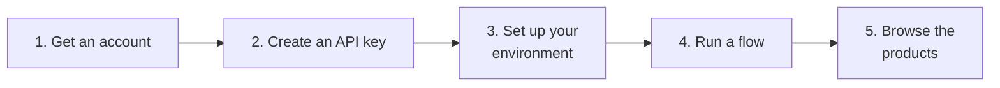

# Quickstart: your first flow

This quickstart shows how to run one of the [Prefect flows](../rs-client-libraries/docs/doc/flows/index.md)
delivered by default with RS-Python, then how to look at the generated products. Writing your own flows is
covered in the [Advanced flow management](../rs-client-libraries/docs/doc/advanced/custom-flow.md) section.

1. **Get an account** on the platform: ask your platform administrator to create your Keycloak account and to
   give you the rights you need (see [User rights and API keys](user-rights.md#available-rights)). The
   administrator also initialises the shared processing environment of your user group (see
   [Initialise the processing environment](../administration/init-processing-environment.md)).
2. **Create an API key** with the API Key Manager, see [API keys](user-rights.md#api-keys).
3. **Set up your environment**: store your API key and your object storage credentials in Prefect, so that the
   flows can run on your behalf, see [Set up your environment](setup-environment.md).
4. **Run a flow** from the Prefect dashboard and monitor it, see [Run existing flows](run-existing-flows.md).
5. **Browse the generated products** in the catalog with the STAC browser, the Swagger page or Python code, and
   download them, see [Browse products](../services/browse-products.md).

Don't skip any step: most of the issues met by new users come from a missing right, a missing API key or a
Prefect block that was not initialised.

The URLs given in this documentation are those of the reference platform, `ops.rs-python.eu`. Replace this domain
name by the one of your own platform. All the URLs are listed in [Useful links](../annexes/links.md).
