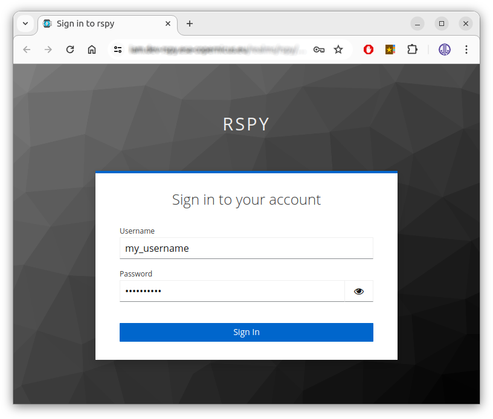
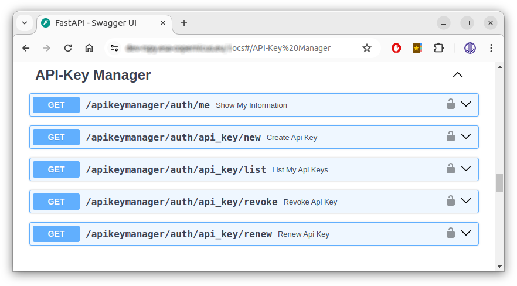
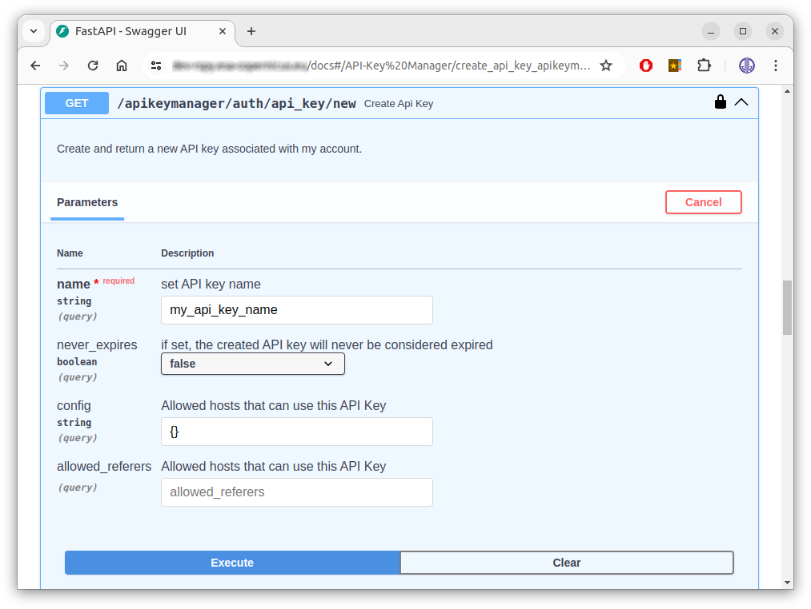
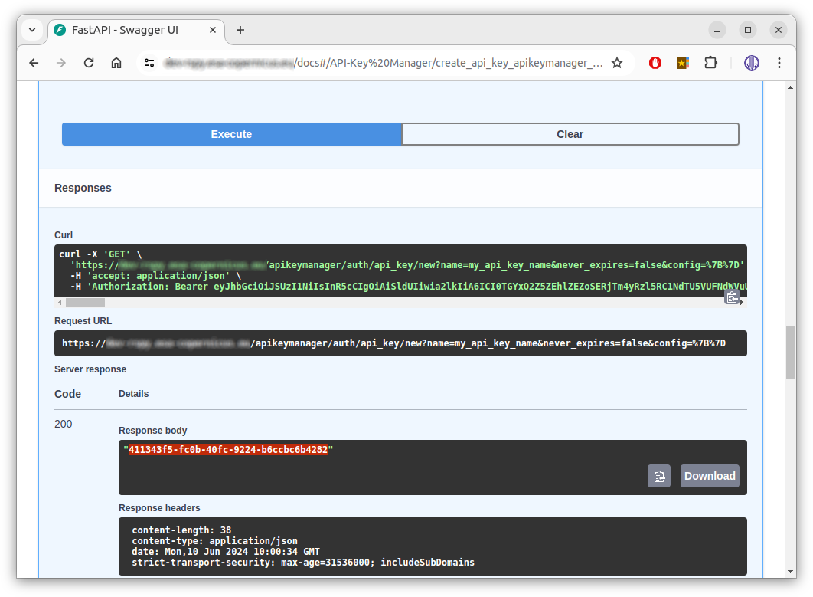
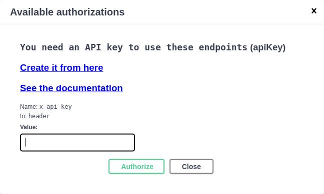

# User rights and API keys

All the RS-Python services are protected: to use them, you need an account on the platform
[Keycloak](https://www.keycloak.org/) instance, created by an administrator (see
[Create accounts and assign permissions](../administration/accounts-permissions.md)).

Two different notions are involved:

- **Authentication** answers the question *who are you?* You prove your identity either with your Keycloak
  login and password ([OAuth2](https://oauth.net/2/) authentication), or with an API key.
- **Authorisation** answers the question *what are you allowed to do?* Your rights are the
  [Keycloak roles](#available-rights) assigned to your account by an administrator. They are the same whatever the
  authentication method.

To check your user name and your rights, open the `/auth/me` endpoint of the rs-server website, e.g.
<https://rspy.ops.rs-python.eu/auth/me> on the reference platform (replace `ops.rs-python.eu` by the domain name
of your own platform).

## Authentication methods

### OAuth2 authentication

When you open any RS-Python web page (Swagger, STAC browser, Prefect, JupyterHub, Grafana...) for the first time,
you are redirected to the Keycloak login page:



You are then authenticated with a session cookie, that has a short lifespan for security reasons (the token
lifespan is set by the administrators in the Keycloak *Realm settings > Tokens* tab). You must log in again
regularly, so this method is suitable for interactive use and for short scripts or flows that only last a few
minutes, but not for long-running processing.

To log in with a different Keycloak account, either remove your cookies from your browser settings, or use an
incognito/private browser session. From the Swagger page, you can also use the *Login* and *Logout* links at the
top of the page.

### API keys

For scripts, notebooks and [Prefect flows](../rs-client-libraries/docs/doc/flows/authentication.md), use an API
key instead: it has a longer lifespan, that you choose when you create it. An API key carries your identity and
your rights: **keep it secret**.

API keys are managed by the [API Key Manager](https://github.com/csgroup-oss/apikey-manager) service:

1. Open the API Key Manager Swagger page, e.g. <https://apikeymanager.ops.rs-python.eu/docs> on the reference
   platform. Log in with your Keycloak account if requested.

    

2. Expand the `Create Api Key` endpoint, click the `Try it out` button on the right, fill in your API key
   parameters and click the `Execute` button at the bottom:

    - **name**: free text, to recognise your key.
    - **never_expires**: if `false`, the API key expires after 15 days.
    - **config** and **allowed_referers**: not used.

    

3. Copy your new API key value from the `Response body` frame, without the quotes, and save it in a safe place:

    

The other API Key Manager endpoints allow you to:

- **Show My Information**: show your Keycloak account information and roles,
- **List My Api Keys**: list your API keys and their usage,
- **Revoke Api Key**: revoke one of your API keys, e.g. if it has leaked,
- **Renew Api Key**: renew one of your API keys, and reactivate it if it was revoked.

To use your API key from the [Swagger page](../services/swagger.md), click one of the lock icons and enter your
API key value:



From the command line or from your own code, pass your API key in the `x-api-key` HTTP header:

```shell
curl -H "x-api-key: <your-api-key>" https://rspy.ops.rs-python.eu/catalog/collections
```

From Python, the [rs-client-libraries](../rs-client-libraries/docs/doc/index.md) read your API key from the
`RSPY_APIKEY` environment variable. To use it from the Prefect flows, see
[Set up your environment](setup-environment.md).

## Available rights

The rights are [Keycloak roles](https://www.keycloak.org/docs/latest/server_admin/index.html#assigning-permissions-using-roles-and-groups).
The platform administrator may grant you all or part of the following roles.

### Catalog

You always have all the rights on the collections that you own. To access the collections of other users, you
need these roles, where `<owner>` is the owner of the collection, `<collection>` the collection identifier, and
both can be replaced by the `*` wildcard:

| Keycloak role | Access |
|---|---|
| `rs_catalog_<owner>:<collection>_read` | Read the collection `<collection>` owned by `<owner>`, search its items. |
| `rs_catalog_<owner>:<collection>_write` | Create, update and delete items in the collection, update or delete the collection. |
| `rs_catalog_<owner>:<collection>_download` | Download the assets of the items of the collection. |

For example, `rs_catalog_copernicus:*_read` allows to read all the collections of the `copernicus` user, and
`rs_catalog_*:s3-l0_download` allows to download the assets of the `s3-l0` collections of all the users.

!!! note "Collection names"

    In the catalog API, a collection is identified by `<owner>:<collection>`, e.g. `copernicus:s3-l0`. When the
    owner is omitted, your own user name is used. See
    [Catalog](../rs-server/docs/doc/users/catalog.md#collections-and-ownership) for details.

### External data sources

Access is given per station or instance. `<station>` is the station or instance identifier configured on the
platform, e.g. `ins`, `mps`, `mti`, `nsg`, `sgs` for the CADIP stations, `adgs` for the AUXIP instance, `s1a`,
`s2b`... for the PRIP instances.

| Keycloak role | Access |
|---|---|
| `rs_cadip_<station>_read` | Search the sessions of the CADIP station `<station>`. |
| `rs_auxip_<station>_read` | Search the auxiliary data of the AUXIP instance `<station>`. |
| `rs_prip_<station>_read` | Search the products of the PRIP instance `<station>`. |
| `rs_cadip_landing_page`, `rs_auxip_landing_page`, `rs_prip_landing_page` | Read the landing page, conformance and list of collections of the CADIP, AUXIP or PRIP service, e.g. from the STAC browsers. |

Administrators usually define [composite roles](https://www.keycloak.org/docs/latest/server_admin/index.html#con-composite-roles_server_administration_guide)
to ease the management, e.g. `rs_cadip_all_read` that includes the read roles of all the CADIP stations, or
`rs_all_landing_page` that includes all the landing page roles.

### Staging

| Keycloak role | Access |
|---|---|
| `rs_processes_staging_read` | Read the staging process description and the status of the staging jobs. |
| `rs_processes_staging_execute` | Execute staging jobs. |
| `rs_processes_staging_dismiss` | Dismiss (cancel) running staging jobs. |
| `rs_processes_staging_download_<station>` | Download products from the station `<station>` during a staging job. |

### Object storage (OSAM)

Every authenticated user can get their own S3 credentials with the `/storage/account/credentials` endpoint. The
other endpoints are reserved to administrators:

| Keycloak role | Access |
|---|---|
| `rs_osam_update` | Synchronise the object storage accounts and rights with Keycloak (`/storage/accounts/update` and `/storage/account/{user}/update`). |

The rights on the S3 buckets are computed by OSAM from your catalog roles, see
[OSAM](../rs-server/docs/doc/users/osam.md).

### Applications

The access to the applications of the [virtual environment](../services/virtual-environment/index.md) is granted
by Keycloak groups and roles configured at deployment time:

| Application | Access |
|---|---|
| [JupyterHub](../services/virtual-environment/jupyterhub.md) | Members of the groups listed in the JupyterHub `allowedGroups` setting (`RS-JUPYTER-USER` by default). Members of the `adminGroups` (`RS-ADMIN` by default) can also administrate JupyterHub. |
| [Prefect](../services/virtual-environment/prefect.md) | Users with one of the roles listed in the Prefect instance `allowedRoles` setting (`RS-JUPYTER-USER` by default). Each user group can have its own Prefect instance. |
| [Grafana](../administration/monitoring.md) | Administrators and operators. |
| [Swagger](../services/swagger.md) and [STAC browsers](../services/browse-products.md) | All authenticated users. Each request is then checked against the roles above. |

If you need additional rights, contact your platform administrator.
