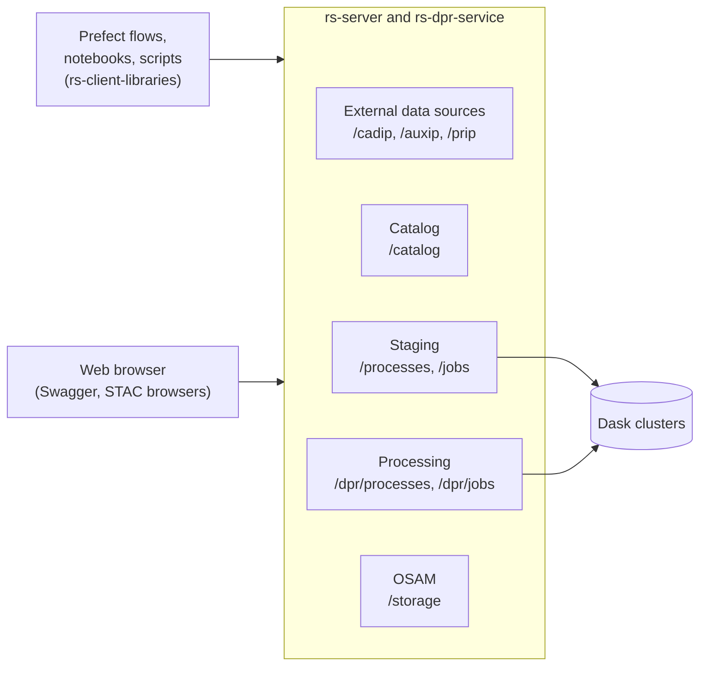

# Services and libraries

This section describes the services and libraries that RS-Python provides to its users.

| Service or library | Description | Source code |
|---|---|---|
| [rs-server](../rs-server/docs/doc/index.md) | The central web services: [external data sources](../rs-server/docs/doc/users/external-data-sources.md) (CADIP, AUXIP, PRIP), [catalog](../rs-server/docs/doc/users/catalog.md), [staging](../rs-server/docs/doc/users/staging.md), [OSAM](../rs-server/docs/doc/users/osam.md) and the [frontend](../rs-server/docs/doc/users/frontend.md) that aggregates their documentation. | [rs-server](https://github.com/RS-PYTHON/rs-server) |
| [DPR processors](../rs-dpr-service/docs/doc/index.md) | The web service that runs the DPR processors on the Dask clusters. | [rs-dpr-service](https://github.com/RS-PYTHON/rs-dpr-service) |
| [rs-client-libraries](../rs-client-libraries/docs/doc/index.md) | The Python library to call the services, and the Prefect flows. | [rs-client-libraries](https://github.com/RS-PYTHON/rs-client-libraries) |
| [Browse products](browse-products.md) | How to search the stations and the catalog, and download the products. | |
| [Virtual environment](virtual-environment/index.md) | Your workspace: [JupyterHub](virtual-environment/jupyterhub.md), [Dask](virtual-environment/dask.md) and [Prefect](virtual-environment/prefect.md). | [rs-workflow-env](https://github.com/RS-PYTHON/rs-workflow-env) |
| [Swagger](swagger.md) | Call the web services from your browser. | |

All the web services are exposed behind a single domain name (e.g. `rspy.ops.rs-python.eu` on the reference
platform), protected by the same [authentication](../getting-started/user-rights.md), and follow open standards:

- the **[SpatioTemporal Asset Catalog (STAC)](https://stacspec.org/)** specification and the
  [STAC API](https://github.com/radiantearth/stac-api-spec) to describe and search all the data, whatever its
  source,
- **[OGC API - Processes](https://ogcapi.ogc.org/processes/)** for the asynchronous services (staging and
  processing), that run their tasks on [Dask](https://www.dask.org/) clusters.

