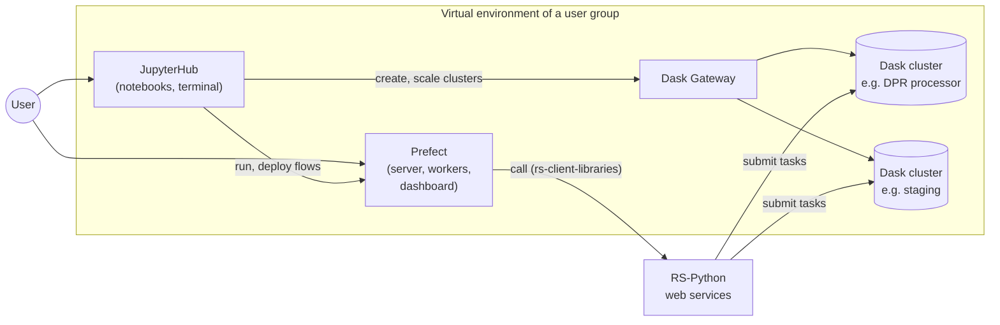

# Virtual environment

The RS-Python platform offers a dedicated workspace to each user group (e.g. each organisation or company),
made of shared services:

- a [JupyterHub](jupyterhub.md) environment, for interactive development, analysis and experimentation,
- a [Prefect](prefect.md) instance, to orchestrate and monitor the processing workflows,
- a [Dask Gateway](dask.md), to create the Dask clusters that distribute the computations (DPR processors and
  staging tasks) across several workers.

These services run within a dedicated pool of CPU and RAM resources allocated to the group, ensuring predictable
performance and isolation from the other groups (see
[Isolation between user groups](../../rs-infra-core/docs/how-to/isolation-user-groups.md)).

| Service | URL on the reference platform | Documentation |
|---|---|---|
| JupyterHub | <https://processing.ops.rs-python.eu/jupyter> | [JupyterHub documentation](https://jupyterhub.readthedocs.io/), [JupyterLab documentation](https://jupyterlab.readthedocs.io/) |
| Prefect dashboard | <https://processing.ops.rs-python.eu/dashboard> | [Prefect documentation](https://docs.prefect.io/v3/get-started) |
| Dask dashboards | `https://dash-dask.processing.ops.rs-python.eu/clusters/<cluster-id>/status` | [Dask documentation](https://docs.dask.org/), [Dask Gateway documentation](https://gateway.dask.org/) |

The virtual environment is deployed by the [rs-workflow-env](../../rs-workflow-env/README.md) repository.
